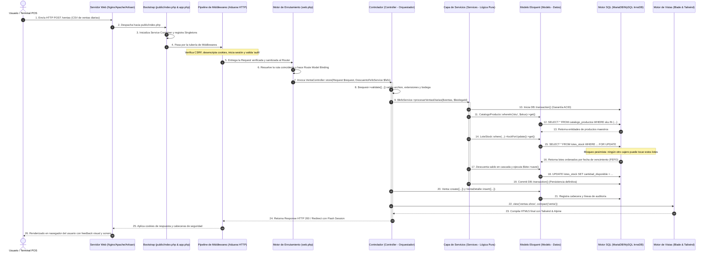
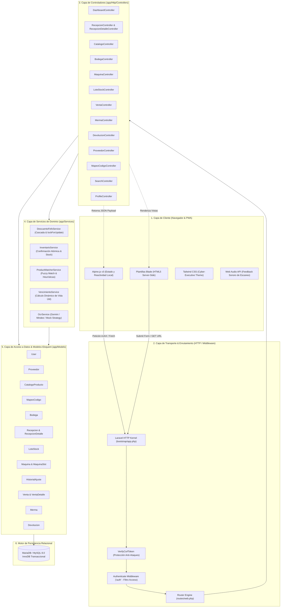
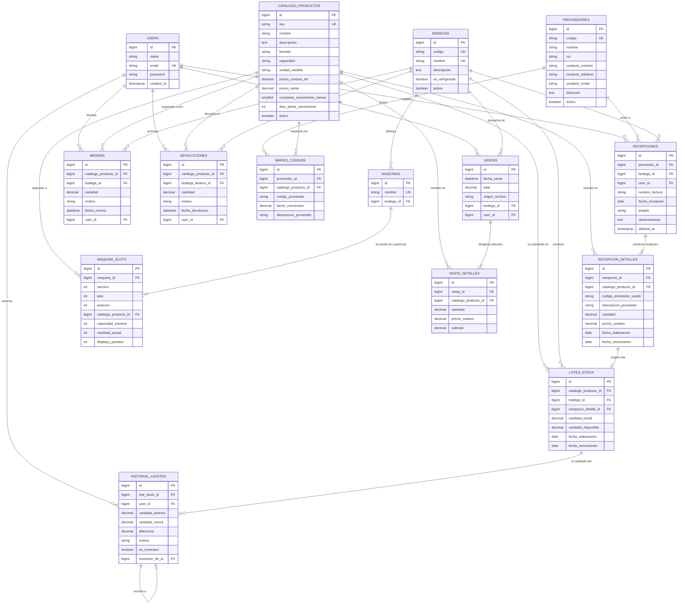
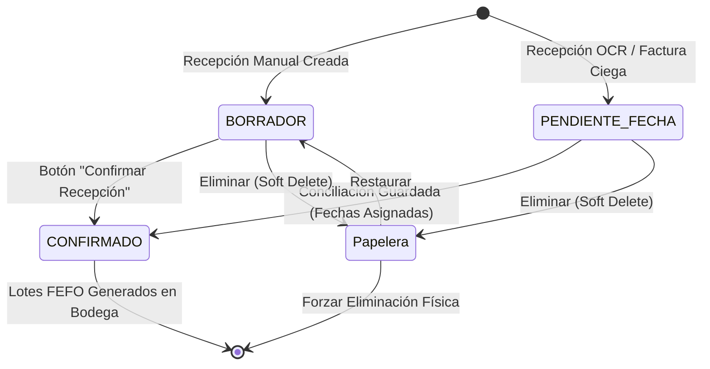
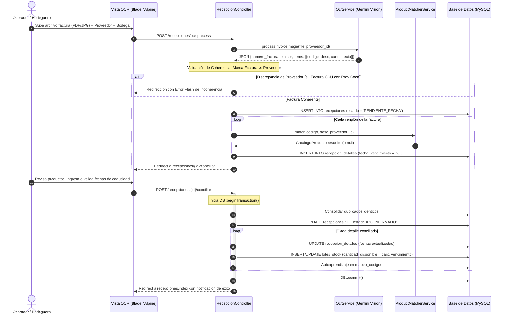
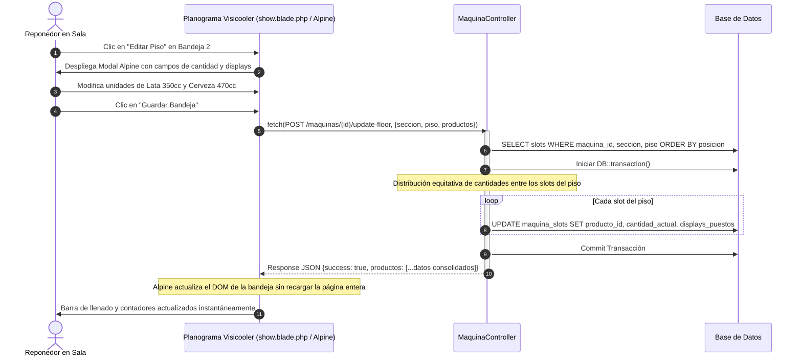

# DOCUMENTACIÓN ARQUITECTÓNICA INTEGRAL: BACKEND, FRONTEND, MVC Y BASE DE DATOS
## Sistema ERP Dallas Manager (Control & Gestión de Inventarios FEFO, Recepciones Inteligentes y Visicoolers)


## TABLA DE CONTENIDOS

1. [Introducción y Propósito del Sistema](#1-introducción-y-propósito-del-sistema)
   - 1.1 Visión General del Negocio
   - 1.2 Principales Desafíos Resueltos
   - 1.3 Stack Tecnológico Integral
2. [El Backend y el Patrón Modelo-Vista-Controlador (MVC) en Laravel y ERP Dallas](#2-el-backend-y-el-patrón-modelo-vista-controlador-mvc-en-laravel-y-erp-dallas)
   - 2.1 ¿Qué es el Backend y cuál es su Rol en una Aplicación Web?
   - 2.2 El Patrón MVC Explicado Paso a Paso (La Analogía del Restaurante y Separación de Responsabilidades)
   - 2.3 ¿Qué es un Middleware? El Guardián de la Petición HTTP (Pipeline y Capas de Cebolla)
   - 2.4 Ciclo de Vida Completo de una Petición HTTP en Laravel (Lifecycle Step-by-Step)
   - 2.5 Los Pilares del Patrón en ERP Dallas con Código Real:
     - 2.5.1 El Modelo (Model - Eloquent ORM)
     - 2.5.2 La Vista (View - Blade + Alpine.js)
     - 2.5.3 El Controlador (Controller - Skinny Orchestrator)
     - 2.5.4 La Capa de Servicios de Dominio (Service Layer)
   - 2.6 Diagrama Arquitectónico de Capas y Flujo MVC
3. [Arquitectura Detallada del Backend](#3-arquitectura-detallada-del-backend)
   - 3.1 Sistema de Enrutamiento y Middlewares (`routes/web.php`, `routes/auth.php`)
   - 3.2 Desglose Módulo por Módulo de los Controladores (`app/Http/Controllers`)
   - 3.3 Desglose Exhaustivo de Modelos Eloquent (`app/Models`)
   - 3.4 Desglose de la Capa de Servicios de Dominio (`app/Services`)
   - 3.5 Registro Cronológico de Migraciones de Base de Datos (`database/migrations`)
   - 3.6 Comandos de Consola y Tareas Programadas (`routes/console.php` / Artisan)
4. [Arquitectura de Base de Datos y Modelo de Datos](#4-arquitectura-de-base-de-datos-y-modelo-de-datos)
   - 4.1 Diagrama Entidad-Relación Completo (ERD Mermaid)
   - 4.2 Diccionario Exhaustivo de Tablas y Atributos
   - 4.3 Relaciones Eloquent, Llaves Foráneas e Integridad Referencial
   - 4.4 Índices de Rendimiento y Optimización de Consultas
   - 4.5 Enumeraciones y Estados del Sistema
5. [Lógica de Negocio y Motor de Inventario en Base de Datos](#5-lógica-de-negocio-y-motor-de-inventario-en-base-de-datos)
   - 5.1 Principio FEFO (*First Expired, First Out*)
   - 5.2 Descuento en Cascada con Bloqueo Concurrente (*lockForUpdate*)
   - 5.3 Auditoría, Trazabilidad y Reversión de Ajustes
   - 5.4 Autoaprendizaje de Códigos de Proveedor (*Mapeo Dinámico*)
6. [Arquitectura del Frontend](#6-arquitectura-del-frontend)
   - 6.1 Sistema de Diseño Visual (*Cyber-Executive Dark Theme*)
   - 6.2 Pipeline de Assets (Vite, Tailwind CSS, Alpine.js)
   - 6.3 Progresive Web App (PWA) y Offline Caching
   - 6.4 Estructura de Layouts y Plantillas Maestras
   - 6.5 Catálogo de Componentes Blade Reutilizables
7. [Desglose Módulo por Módulo del Frontend](#7-desglose-módulo-por-módulo-del-frontend)
   - 7.1 Dashboard Ejecutivo & Radar FEFO en Tiempo Real
   - 7.2 Catálogo Maestro de Productos
   - 7.3 Bodegas & Gestión Multialmacén
   - 7.4 Visicoolers & Planograma Digital de Máquinas
   - 7.5 Módulo de Recepciones e Ingesta de Facturas (OCR, Kiosko Scanner, Manual y Conciliador)
   - 7.6 Movimientos de Stock: Carga de Ventas POS (CSV Inteligente)
   - 7.7 Mermas y Devoluciones
   - 7.8 Mapeo de Códigos de Proveedor
   - 7.9 Gestión de Proveedores
   - 7.10 Buscador Global Omnibox (`Ctrl + K`)
8. [Diagramas de Secuencia y Flujos de Datos Integrados](#8-diagramas-de-secuencia-y-flujos-de-datos-integrados)
   - 8.1 Ingesta OCR -> Máquina de Estados -> Lotes FEFO
   - 8.2 Procesamiento de Ventas POS -> Descuento FEFO
   - 8.3 Actualización Dinámica del Planograma de Visicooler
9. [Seguridad, Auditoría y Conclusiones Técnicas](#9-seguridad-auditoría-y-conclusiones-técnicas)
10. [Glosario Maestro de Términos Técnicos y Conceptos Clave (Guía Rápida para la Defensa)](#10-glosario-maestro-de-términos-técnicos-y-conceptos-clave-guía-rápida-para-la-defensa)
    - 10.1 Conceptos Fundamentales de Arquitectura y Web
    - 10.2 Conceptos de Control, Seguridad y Transporte (Middlewares, CSRF, Auth)
    - 10.3 Conceptos de Base de Datos y Persistencia (ORM, Migraciones, Transacciones ACID)
    - 10.4 Conceptos de Lógica de Negocio en ERP Dallas (FEFO, Lotes, Planograma, Conciliación)
    - 10.5 Tabla Resumen "Término en 10 Segundos" (Cheat-Sheet para Memorizar)

---

## 1. INTRODUCCIÓN Y PROPÓSITO DEL SISTEMA

### 1.1 Visión General del Negocio
**ERP Dallas Manager** es una plataforma integral de gestión empresarial especializada en negocios con alta rotación de productos perecibles, particularmente enfocado en la distribución y venta minorista de bebidas, cervezas y alimentos envasados (marcas principales: Compañía Cervecerías Unidas - CCU, Coca-Cola Embonor/Andina, Dimak, PF Alimentos, entre otros).

A diferencia de los sistemas ERP convencionales que tratan el inventario como un número estático global por producto, Dallas Manager implementa una arquitectura basada en **lotes trazables por fecha de caducidad**, gobernados por el principio **FEFO (First Expired, First Out)**, garantizando que el stock más antiguo o próximo a caducar sea el primero en consumirse comercialmente.

### 1.2 Principales Desafíos Resueltos
1. **Control de Vencimientos Críticos:** Alertas visuales y cronológicas (Radar FEFO) para prevenir pérdidas financieras por productos vencidos en sala o cámaras de refrigeración.
2. **Disparidad de Códigos de Proveedores:** Automatización de mapeos entre los códigos internos de facturación de cada proveedor (CCU, Embonor) y el SKU maestro del catálogo, con algoritmos de resolución semántica y autoaprendizaje.
3. **Ingesta Inteligente de Documentos:** Recepción automatizada mediante visión artificial e inteligencia artificial (Google Gemini Vision / Mindee OCR) que extrae facturas físicas o digitales en segundos, detecta discrepancias entre proveedor seleccionado y emisor real, y permite conciliar fechas en una máquina de estados controlada.
4. **Kiosko de Recepción Rápida:** Modo escáner de códigos de barra para operadores en andén con respuesta auditiva y visual inmediata.
5. **Planograma Digital de Visicoolers (Máquinas Frigoríficas):** Mapeo bidimensional y tridimensional de secciones, bandejas (pisos) y caras (slots) para visicoolers de exhibición en sala de ventas, controlando capacidades, displays promocionales y reposición en tiempo real sin recargar página.
6. **Importación Flexible de Ventas POS:** Capacidad de ingerir archivos de venta exportados de sistemas POS comerciales (CSV/TXT), filtrando automáticamente ítems ajenos (abarrotes, pan, etc.) y ejecutando el descuento en cascada de lotes en la base de datos con transacciones ACID aisladas.

### 1.3 Stack Tecnológico Integral

| Capa | Tecnología | Rol y Versión |
| :--- | :--- | :--- |
| **Backend Core** | PHP 8.3+ / Laravel 11/12+ | Lógica de negocio, ORM Eloquent, migraciones, controladores, middleware de autenticación y transacciones |
| **Base de Datos** | MariaDB / MySQL 8.0 / SQLite 3 | Motor relacional con soporte transaccional InnoDB, índices compuestos y claves foráneas estrictas |
| **Motor Frontend** | Laravel Blade | Renderizado del lado del servidor de plantillas HTML5 semánticas y componentes reutilizables |
| **Estilos & UI** | Tailwind CSS v3 / PostCSS | Sistema de diseño declarativo con estética ejecutiva oscura, micro-animaciones y diseño adaptable (*Responsive*) |
| **Reactividad Cliente** | Alpine.js v3 | Micro-reactividad declarativa en el DOM (modales, carritos de escáner, planogramas interactivos, búsquedas dinámicas) |
| **Empaquetador Assets** | Vite 8 + Laravel Vite Plugin | Hot Module Replacement (HMR), transpilación y minificación ultrarrápida de scripts y hojas de estilo |
| **Servicios IA / OCR** | Google Gemini 2.0 / Mindee OCR | Extracción semántica de tablas, fechas, montos y metadatos desde facturas en PDF e imágenes |
| **Hojas de Cálculo** | PhpSpreadsheet | Importación y lectura de catálogos masivos en formato Microsoft Excel (.xlsx) |
| **Cliente PWA** | Web App Manifest + Service Worker | Instalación en dispositivos móviles y de mano, caché de assets y soporte de pantalla completa |

---

## 2. EL BACKEND Y EL PATRÓN MODELO-VISTA-CONTROLADOR (MVC) EN LARAVEL Y ERP DALLAS

### 2.1 ¿Qué es el Backend y cuál es su Rol en una Aplicación Web?

Para comprender cualquier sistema web empresarial como **ERP Dallas Manager**, es fundamental diferenciar las dos grandes mitades que componen el software moderno: el **Frontend** y el **Backend**.

```
+---------------------------------------------------------------------------------------+
|                                    EL NAVEGADOR WEB                                   |
|   +-------------------------------------------------------------------------------+   |
|   |                  FRONTEND (Lo que el Usuario Ve e Interactúa)                 |   |
|   |   HTML5 Semántico + Tailwind CSS (Diseño Visual) + Alpine.js (Micro-Reactividad) |   |
|   +-------------------------------------------------------------------------------+   |
+------------------------------------------+--------------------------------------------+
                                           |  Petición HTTP (GET / POST / PUT / DELETE)
                                           |  Envío de Formularios, JSON, Clics, Escaneo
                                           v
+---------------------------------------------------------------------------------------+
|                             EL SERVIDOR (EL BACKEND)                                  |
|   +-------------------------------------------------------------------------------+   |
|   | 1. GUARDIÁN / MIDDLEWARE: Autenticación ('auth'), Token CSRF, Sesiones         |   |
|   | 2. ENRUTADOR (Router): Dirige la URL a su método de destino                   |   |
|   | 3. CONTROLADOR: Orquesta la comanda, valida entradas y despacha respuestas    |   |
|   | 4. SERVICIOS DE DOMINIO: Algoritmos FEFO, transacciones bancarias, IA OCR      |   |
|   | 5. MODELOS (Eloquent ORM): Reglas de integridad y abstracción de datos        |   |
|   | 6. MOTOR DE BASE DE DATOS: Tablas relacionales, bloqueo pesimista, ACID       |   |
|   +-------------------------------------------------------------------------------+   |
+---------------------------------------------------------------------------------------+
```

#### 2.1.1 La Analogía del Cajero Automático y el Banco
Imagina un cajero automático (ATM):
- **El Frontend es la pantalla táctil del cajero:** Los botones brillantes, las animaciones que dicen "Ingrese su tarjeta", el teclado numérico y el diseño de la interfaz. Su trabajo es capturar tu orden y mostrarte mensajes amigables. Sin embargo, la pantalla del cajero **no sabe ni tiene dinero por sí misma**. Si alguien intentara hackear la pantalla física, no obtendría nada de valor porque la pantalla no guarda los saldos ni toma las decisiones.
- **El Backend es la bóveda del banco y el sistema bancario central:** Está ubicado a kilómetros de distancia en un centro de datos ultraseguro. Cuando presionas "Retirar $10.000", el cajero envía una solicitud cifrada al backend. El backend verifica quién eres (autenticación), comprueba si tu cuenta tiene saldo suficiente (regla de negocio), bloquea tu cuenta por un milisegundo para que no retires dos veces al mismo tiempo (concurrencia y ACID), resta los $10.000 de la base de datos (persistencia) y finalmente le responde al cajero: *"Todo en orden, entrega 1 billete de diez mil"*.

En **ERP Dallas Manager**, el **Backend** es el cerebro invisible pero omnipotente que corre en el servidor web. El usuario nunca tiene acceso directo a su código ni a sus archivos; solo interactúa con él a través de peticiones HTTP seguras.

#### 2.1.2 Componentes del Ecosistema Backend en ERP Dallas
1. **Servidor Web / Entorno de Ejecución:** PHP 8.4 corriendo sobre Nginx/Apache o el servidor de desarrollo Artisan, ejecutando el código a nivel de máquina servidora.
2. **Framework de Aplicación (Laravel 12+):** Provee la infraestructura de nivel empresarial: contenedor de inyección de dependencias (*Service Container*), gestión de rutas, sistema de migraciones de base de datos, encriptación criptográfica y abstracción de bases de datos.
3. **Motor de Persistencia Relacional:** MariaDB / MySQL 8.0 con motor de almacenamiento transaccional **InnoDB**, garantizando cumplimiento de las propiedades **ACID** (Atomicidad, Consistencia, Aislamiento y Durabilidad).
4. **Integraciones Externas:** Conexión segura mediante cURL/Guzzle hacia la API de Google Gemini 2.0 y Mindee OCR para la ingesta inteligente de facturas electrónicas.

#### 2.1.3 Las Cuatro Grandes Responsabilidades del Backend
1. **Seguridad y Control de Acceso:** Nadie puede ver el stock, ingresar facturas ni modificar cajas a menos que haya demostrado fehacientemente su identidad mediante credenciales válidas cifradas en hash (Bcrypt/Argon2).
2. **Lógica de Dominio y Reglas Comerciales:** Todo el conocimiento especializado del negocio reside aquí: ¿Qué lote debe salir primero? (Algoritmo FEFO); ¿Cómo convertir 2 cajas de 12 unidades en 24 unidades individuales?; ¿Cómo detectar si un producto ya existe para evitar duplicados accidentales?
3. **Integridad Transaccional y Persistencia:** Asegurar que si una venta descuenta 10 latas de cerveza, esas 10 latas se descuenten de forma atómica de los lotes correctos en la base de datos. Si la luz se corta o el servidor falla a la mitad del proceso, la base de datos revierte la operación (*Rollback*) para que nunca queden datos corruptos o saldos fantasmas.
4. **Comunicaciones e Intercambio de Información:** Generar respuestas en formato HTML compilado para el navegador o en formato JSON estructurado para componentes reactivos asíncronos y APIs.

---

### 2.2 El Patrón MVC Explicado Paso a Paso (La Analogía del Restaurante)

El patrón de arquitectura de software **Modelo-Vista-Controlador (MVC)** fue creado para resolver uno de los problemas más destructivos en la ingeniería de software: el llamado **"Código Espagueti"** (mezclar en un solo archivo consultas SQL, cálculos matemáticos, etiquetas HTML y estilos visuales).

El principio rector de MVC es la **Separación de Responsabilidades (Separation of Concerns - SoC)**: cada pieza de código tiene un único trabajo bien definido y no invade el trabajo de los demás.

Para explicarlo de forma inolvidable durante una defensa técnica, utilizaremos la **Analogía del Restaurante de Alta Cocina**:

```
+---------------------------------------------------------------------------------------+
|                              EL RESTAURANTE DE ALTA COCINA                            |
|                                                                                       |
|   1. COMENSAL (Cliente / Navegador)                                                   |
|      Se sienta a la mesa, consulta la carta y realiza una orden:                       |
|      "Mesero, por favor regístreme la venta del lote de Coca-Cola".                   |
|                                     |                                                 |
|                                     v                                                 |
|   2. MESERO (El Controlador / Controller)                                             |
|      - Toma la comanda (Recibe la Request HTTP).                                      |
|      - Revisa que la comanda esté completa: "¿Indicó la mesa y la cantidad?"          |
|        (Validación de formularios: $request->validate()).                             |
|      - EL MESERO NO COCINA. Va a la cocina y le entrega la orden a los especialistas. |
|                                     |                                                 |
|                  +------------------+------------------+                              |
|                  |                                     |                              |
|                  v                                     v                              |
|   3. CHEF PRINCIPAL / SOUS-CHEF          4. DESPENSA Y BODEGA REFRIGERADA             |
|      (Capa de Servicios - app/Services)     (El Modelo - Eloquent & Base de Datos)    |
|      - Aplica la receta maestra:            - El Modelo (LoteStock) conoce las        |
|        Algoritmo FEFO en cascada,              propiedades de cada ingrediente.       |
|        cálculo de mermas y auditoría.       - Va a la despensa (Base de Datos)        |
|      - Coordina las ollas y fuegos.           y rescata las materias primas crudas.   |
|                  |                                     |                              |
|                  +------------------+------------------+                              |
|                                     |                                                 |
|                                     v                                                 |
|   5. EL EMPLATADO Y PRESENTACIÓN (La Vista / View - Blade + Tailwind + Alpine)        |
|      El cliente no come ingredientes crudos ni cebollas sin picar. El plato se sirve  |
|      en vajilla impecable, con salsa decorada, guarnición caliente y temperatura      |
|      perfecta. Es la interfaz visual lista para que el comensal la disfrute.          |
+---------------------------------------------------------------------------------------+
```

#### Los 3 Actores Principales del Patrón:

1. **El Modelo (Model - `app/Models`):**
   - **En el restaurante:** Es la despensa, el refrigerador y las fichas técnicas de los ingredientes. Sabe cuánto pesa cada insumo, cuándo caduca y con qué otros ingredientes se relaciona.
   - **En el código de ERP Dallas:** Son clases como `LoteStock`, `CatalogoProducto`, `Recepcion`, `Bodega`. Representan las tablas de la base de datos mediante el ORM Eloquent. Definen qué campos son seguros para escribir (`$fillable`), cómo se convierten los datos (`$casts`), cómo se conectan las tablas (`belongsTo`, `hasMany`) y consultas frecuentes reutilizables (`scopes`).
   - **Regla de oro:** El Modelo jamás habla con el navegador web, nunca recibe formularios directamente ni dibuja etiquetas HTML.

2. **La Vista (View - `resources/views`):**
   - **En el restaurante:** Es el salón comedor, la vajilla, la iluminación y la presentación del plato terminado.
   - **En el código de ERP Dallas:** Son los archivos `.blade.php`. Toman los datos limpios que les envía el controlador y los transforman en HTML5 semántico estructurado, con estilos ejecutivos oscuros de **Tailwind CSS** y reactividad ágil de **Alpine.js**.
   - **Regla de oro:** La Vista jamás ejecuta consultas a la base de datos (nunca hace `SELECT` ni `UPDATE`), jamás calcula algoritmos de inventario ni toma decisiones de seguridad. Solo muestra información y captura eventos del usuario.

3. **El Controlador (Controller - `app/Http/Controllers`):**
   - **En el restaurante:** Es el mesero profesional. Es el único que interactúa cara a cara con el comensal. Recibe el pedido, valida que los datos no vengan vacíos ni maliciosos, camina a la cocina a solicitar lo que haga falta y, cuando todo está cocinado, toma el plato terminado y se lo entrega al cliente.
   - **En el código de ERP Dallas:** Son clases como `VentaController`, `RecepcionController`, `CatalogoController`. Actúan como directores de orquesta. Reciben el objeto `Request $request`, ejecutan `$request->validate([...])`, llaman a los Servicios o Modelos, y retornan una vista Blade (`return view(...)`) o una respuesta asíncrona (`return response()->json(...)`).
   - **Regla de oro:** El Controlador debe ser **"delgado" (*Skinny Controller*)**. No debe acumular cientos de líneas de lógica matemática ni conectarse directamente a APIs de Inteligencia Artificial; esas responsabilidades se delegan a la Capa de Servicios.

#### ¿Por qué es tan valiosa la Separación de Responsabilidades?
- **Mantenibilidad:** Si el dueño del restaurante decide cambiar la vajilla de cerámica por platos de vidrio templado (cambiar el diseño visual en Tailwind CSS), el chef no tiene que cambiar su receta (el Modelo y la base de datos quedan 100% intactos).
- **Escalabilidad:** Si el restaurante decide cambiar el proveedor de harina o comprar un refrigerador nuevo (migrar de MariaDB a PostgreSQL), los meseros (Controladores) siguen pidiendo "harina" de la misma forma y la Vista ni se entera del cambio.
- **Testabilidad:** Podemos probar la receta del chef en un laboratorio sin necesidad de abrir el salón comedor (ejecutar tests automatizados en PHPUnit sin necesidad de levantar un navegador web).

---

### 2.3 ¿Qué es un Middleware? El Guardián de la Petición HTTP (Pipeline y Capas de Cebolla)

> [!IMPORTANT]
> **Pregunta Clave para la Defensa:** *¿Qué es un Middleware en Laravel y para qué sirve?*  
> **Respuesta en 1 frase:** Un Middleware es un **mecanismo de intercepción y filtrado** que se ejecuta **antes** de que una petición HTTP llegue al Controlador (o **después**, justo antes de que la respuesta regrese al navegador), funcionando como una aduana de seguridad o filtro protector.

```
       PETICIÓN ENTRANTE (Request)                   RESPUESTA SALIENTE (Response)
  [ Usuario hace Clic / Envía Formulario ]      [ Navegador recibe HTML / JSON / Alerta ]
                     |                                              ^
                     v                                              |
      +-------------------------------------------------------------------+
      |                      CAPA EXTERNA: EncryptCookies                 |
      |   Desencripta cookies del cliente   |   Encripta cookies salientes|
      +-------------------------------------+-----------------------------+
                     |                                              ^
                     v                                              |
      +-------------------------------------------------------------------+
      |                      CAPA MEDIA: StartSession                     |
      |   Inicia o recupera la sesión       |   Guarda estado de la sesión|
      +-------------------------------------+-----------------------------+
                     |                                              ^
                     v                                              |
      +-------------------------------------------------------------------+
      |                   CAPA DE INTEGRIDAD: VerifyCsrfToken             |
      |   ¿Tiene token CSRF válido?         |   (Pasa la respuesta limpia)|
      |   NO -> Aborta con Error 419        |                             |
      +-------------------------------------+-----------------------------+
                     |                                              ^
                     v                                              |
      +-------------------------------------------------------------------+
      |                   CAPA DE PERÍMETRO: Authenticate ('auth')        |
      |   ¿El usuario ha iniciado sesión?   |   (No interviene en salida) |
      |   NO -> Redirige a /login           |                             |
      +-------------------------------------+-----------------------------+
                     |                                              ^
                     v                                              |
      +-------------------------------------------------------------------+
      |                   EL NÚCLEO: CONTROLADOR Y LÓGICA                 |
      |   RecepcionController / VentaController / DashboardController     |
      +-------------------------------------------------------------------+
```

#### 2.3.1 Dos Metáforas Inolvidables para Entender el Middleware

##### Metáfora 1: El Patovica / Guardia de Seguridad en la Puerta de una Discoteca VIP
Imagina que quieres entrar a una discoteca exclusiva llamada *"Club Dallas"*:
1. En la calle está la gente que quiere entrar (las Peticiones HTTP del navegador).
2. Adentro de la discoteca está la pista de baile, la música y la barra de tragos (el Controlador y la Base de Datos).
3. En la puerta principal hay un guardia de seguridad de 2 metros de altura con traje negro: **el Middleware**.
   - **El guardia te pide tu Cédula de Identidad (`auth` Middleware):** "¿Quién eres? ¿Estás registrado en la lista?". Si no tienes identificación o no estás registrado, el guardia te frena en seco y te dice: *"Usted no puede pasar, váyase a la fila de registro"* (`redirect('/login')`). La música ni se detiene y la barra de tragos ni se entera de que alguien intentó entrar.
   - **El guardia pasa el detector de metales (`VerifyCsrfToken` Middleware):** "¿Traes armas escondidas o una pulsera falsa copiada de otra discoteca?". Si detecta una trampa, te expulsa inmediatamente con un código de rechazo (*HTTP 419 Token Expired*).
   - **El guardia revisa si tienes pulsera dorada (`can:admin` / Roles):** "¿Quieres entrar a la sala de control financiero?". Si eres un operador de bodega y no tienes pase de administrador, te frena con un *HTTP 403 Forbidden*.

##### Metáfora 2: Los Controles de Seguridad de un Aeropuerto Internacional
Cuando viajas en avión, no caminas desde la calle directamente a la cabina del piloto:
- **Puesto 1 (Aduana):** Control de equipaje y rayos X (desencriptado y validación de cookies).
- **Puesto 2 (Migraciones):** Validación de pasaporte y visa vigente (verificación de sesión y usuario autenticado).
- **Puesto 3 (Puerta de Embarque):** Control de tarjeta de embarque del vuelo exacto (permisos sobre la ruta).
- Si superas todos los filtros, accedes a tu asiento en el avión (el Controlador ejecuta tu acción). Si cualquiera de los controles falla, eres escoltado fuera del aeropuerto de forma inmediata.

#### 2.3.2 El Patrón Pipeline (Capa de Cebolla) y el Método `$next($request)`
Técnicamente, en Laravel los middlewares forman una **"tubería" (pipeline)** o **"capas de cebolla"**. La petición entra atravesando capa por capa hacia el centro, y cuando el controlador genera la respuesta, esa respuesta vuelve a salir atravesando las capas en sentido inverso.

Cada middleware en Laravel es una clase PHP con un método fundamental llamado `handle`:

```php
namespace App\Http\Middleware;

use Closure;
use Illuminate\Http\Request;
use Symfony\Component\HttpFoundation\Response;

class VerificarUsuarioActivo
{
    /**
     * Maneja la petición entrante como un filtro aduanero.
     */
    public function handle(Request $request, Closure $next): Response
    {
        // 1. LÓGICA PREVIA (Antes de entrar al controlador):
        // Verificamos si el usuario está autenticado y si su cuenta está habilitada
        if ($request->user() && !$request->user()->activo) {
            // El guardia detiene la petición y redirige con un mensaje de alerta
            return redirect()->route('login')->with('error', 'Su cuenta de operador está suspendida.');
        }

        // 2. DAR PASO AL SIGUIENTE FILTRO O AL CONTROLADOR:
        // Si todo está en orden, invocamos a $next($request)
        $response = $next($request);

        // 3. LÓGICA POSTERIOR (En el camino de salida hacia el navegador):
        // Podemos añadir cabeceras de seguridad HTTP a la respuesta
        $response->headers->set('X-Frame-Options', 'DENY'); //esto ayuda a proteger contra ataques clickjacking
        $response->headers->set('X-XSS-Protection', '1; mode=block'); //esto ayuda a proteger contra ataques XSS
        //xss significa cross site scripting y es un ataque que permite a un atacante inyectar código malicioso en una página web

        return $response;
    }
}
```

#### 2.3.3 Los Middlewares Activos en ERP Dallas Manager
En el archivo `bootstrap/app.php` y en las rutas `routes/web.php` y `routes/auth.php`, Dallas implementa los siguientes guardianes:

| Middleware | Tipo | Función Crítica en ERP Dallas |
| :--- | :---: | :--- |
| `Authenticate` (`auth`) | Perimétrico | Bloquea el acceso a todas las rutas de negocio (`/dashboard`, `/catalogo`, `/recepciones`, `/bodegas`, `/maquinas`, `/ventas`). Si un usuario no logueado intenta escribir la URL en el navegador, es redirigido en 1 milisegundo a `/login`. |
| `RedirectIfAuthenticated` (`guest`) | Navegación | Si un usuario ya inició sesión con éxito e intenta volver a ingresar a `/login` o `/register`, este middleware lo intercepta y lo manda directo a su `/dashboard` para evitar inicios de sesión duplicados. |
| `ValidateCsrfToken` | Seguridad | Verifica que cada petición de modificación (`POST`, `PUT`, `DELETE`) contenga el token criptográfico secreto `@csrf`, blindando al sistema contra ataques de falsificación de peticiones en sitios cruzados. |
| `StartSession` | Estado | Carga y mantiene la sesión HTTP del operador a través de las diferentes pantallas sin necesidad de pedir usuario y clave en cada clic. |
| `ShareErrorsFromSession` | Interfaz | Inyecta de forma automática la variable `$errors` en todas las plantillas Blade. Si una validación falla en el backend, Blade puede pintar instantáneamente las alertas en color rojo. |
| `EncryptCookies` | Criptografía | Cifra todas las cookies con la clave maestra de la aplicación (`APP_KEY`), impidiendo que un usuario malicioso modifique las cookies desde el inspector de su navegador. |

---

### 2.4 Ciclo de Vida Completo de una Petición HTTP en Laravel (Lifecycle Step-by-Step)

Para entender cómo fluye cada acción en ERP Dallas (por ejemplo, registrar una venta o conciliar una factura OCR), a continuación se desglosa el ciclo de vida de una petición HTTP desde que el usuario hace un clic hasta que la pantalla se actualiza:



#### Fases Detalladas del Ciclo de Vida:
1. **Punto de Entrada (`public/index.php`):** Toda petición web entra exclusivamente por este archivo único. Se carga el autoloader de Composer (`vendor/autoload.php`) y se instancia la aplicación (`bootstrap/app.php`).
2. **Contenedor de Inyección de Dependencias (Service Container):** Laravel registra e inicializa los proveedores de servicio (`AppServiceProvider`), enlazando interfaces con sus implementaciones (por ejemplo, resolviendo dependencias de servicios como `DescuentoFefoService` o `OcrService`).
3. **Pipeline de Middlewares Globales y de Grupo (`web`):**
   - Verificación de sesión y cookies seguras.
   - Verificación estricta de token anti-falsificación CSRF.
   - Verificación de identidad (`auth`): Si no está logueado, aborta la petición y redirige a `/login`.
4. **Enrutamiento y *Route Model Binding* (`routes/web.php`):** El enrutador analiza la URL solicitada. Si la ruta utiliza parámetros implícitos como `/bodegas/{bodega}`, Laravel ejecuta automáticamente `Bodega::findOrFail($id)` antes de llegar al controlador, abortando con código 404 si el registro no existe en la base de datos.
5. **Ejecución del Controlador y Validación Declarativa:** El controlador recibe la petición y ejecuta `$request->validate([...])`. Si falla cualquier regla, Laravel interrumpe el flujo y redirige inmediatamente a la vista previa inyectando los errores en la variable `$errors` y repoblando los campos con `old()`.
6. **Delegación a Servicios y Persistencia Transaccional:** La lógica crítica de inventario no se ejecuta dentro del controlador; se delega a `app/Services/`. Las consultas se ejecutan mediante Eloquent ORM sobre transacciones atómicas seguras (`DB::transaction()`).
7. **Generación de la Respuesta (View / JSON):** Si la petición fue tradicional, se compila la plantilla Blade correspondiente; si fue enviada mediante AJAX (Fetch / Alpine), se retorna un objeto JSON estructurado (`response()->json(['success' => true, ...])`).

---

### 2.5 Los Pilares del Patrón en ERP Dallas con Código Real

A continuación, se demuestra cómo se materializa el patrón MVC y la Capa de Servicios en el código fuente real del proyecto:

#### 2.5.1 El Modelo (Model - Eloquent ORM): `app/Models/LoteStock.php`
El modelo representa la tabla `lotes_stock` en la base de datos y define cómo interactúa la aplicación con cada lote físico de mercadería:

```php
namespace App\Models;

use Illuminate\Database\Eloquent\Model;
use Illuminate\Database\Eloquent\Relations\BelongsTo;

class LoteStock extends Model
{
    protected $table = 'lotes_stock';

    // Protección de Asignación Masiva: solo estas columnas pueden escribirse
    protected $fillable = [
        'catalogo_producto_id',
        'bodega_id',
        'recepcion_detalle_id',
        'cantidad_inicial',
        'cantidad_disponible',
        'fecha_elaboracion',
        'fecha_vencimiento',
    ];

    // Conversión Automática de Tipos: fechas como Carbon y cantidades como decimales
    protected $casts = [
        'cantidad_inicial' => 'decimal:2',
        'cantidad_disponible' => 'decimal:2',
        'fecha_elaboracion' => 'date',
        'fecha_vencimiento' => 'date',
    ];

    // Relación Relacional: Un lote pertenece a un producto maestro del catálogo
    public function producto(): BelongsTo
    {
        return $this->belongsTo(CatalogoProducto::class, 'catalogo_producto_id');
    }

    // Scope Local: Filtro reutilizable que entrega solo lotes con saldo ordenados por FEFO
    public function scopeDisponibleFefo($query)
    {
        return $query->where('cantidad_disponible', '>', 0)
            ->whereNotNull('fecha_vencimiento')
            ->orderBy('fecha_vencimiento', 'asc');
    }
}
```

#### 2.5.2 La Vista (View - Blade + Alpine.js): `resources/views/dashboard.blade.php`
La vista no calcula saldos ni ejecuta SQL; solo presenta la información de manera elegante y provee interactividad en el navegador del operador:

```blade
{{-- Inyección de la plantilla maestra --}}
<x-app-layout>
    <x-slot name="header">
        <div class="flex items-center justify-between">
            <h2 class="text-2xl font-bold text-white">Centro de Control & Operaciones</h2>
            <div class="inline-flex items-center gap-2 px-3 py-1.5 rounded-full bg-emerald-500/10 border border-emerald-500/30 text-emerald-400 text-xs">
                <span class="animate-ping h-2 w-2 rounded-full bg-emerald-400"></span>
                <span>100% Sincronizado en Vivo</span>
            </div>
        </div>
    </x-slot>

    {{-- Micro-Reactividad con Alpine.js en el cliente sin recargar la página entera --}}
    <div x-data="dashboardHub()" class="w-full space-y-6 text-slate-100">
        {{-- Tarjetas KPI renderizadas con datos inyectados por el controlador --}}
        <div class="grid grid-cols-1 md:grid-cols-4 gap-4">
            <div class="bg-slate-900/80 border border-slate-800 rounded-2xl p-5 shadow-xl">
                <p class="text-xs text-slate-400 uppercase tracking-wider">Existencias Totales</p>
                <p class="text-3xl font-extrabold text-white mt-1">{{ number_format($totalUnidades) }}</p>
            </div>
            ...
        </div>
    </div>
</x-app-layout>
```

#### 2.5.3 El Controlador (Controller - Skinny Orchestrator): `app/Http/Controllers/VentaController.php`
El controlador actúa como mesero: valida la entrada, delega la tarea pesada al servicio y redirige con un mensaje de éxito:

```php
namespace App\Http\Controllers;

use Illuminate\Http\Request;
use App\Services\DescuentoFefoService;

class VentaController extends Controller
{
    /**
     * Procesa la importación de ventas diarias delegando al servicio FEFO.
     */
    public function store(Request $request, DescuentoFefoService $fefoService)
    {
        // 1. Validación declarativa de la entrada HTTP
        $request->validate([
            'bodega_id' => 'required|exists:bodegas,id',
            'archivo_ventas' => 'required|file|mimes:csv,txt|max:5120',
            'fecha_venta' => 'nullable|date|before_or_equal:today',
        ]);

        // 2. Parseo y limpieza del archivo CSV
        $ventas = $this->parsearCsvVentas($request->file('archivo_ventas'));

        // 3. Delegación al Servicio de Dominio (El controlador NO ejecuta la cascada FEFO)
        $fefoService->procesarVentasDiarias($ventas, (int) $request->bodega_id);

        // 4. Retorno de respuesta al cliente
        return redirect()->route('ventas.index')
            ->with('success', 'Ventas procesadas exitosamente aplicando descuento FEFO por lotes.');
    }
}
```

#### 2.5.4 La Capa de Servicios de Dominio (Service Layer): `app/Services/DescuentoFefoService.php`
La capa de servicios concentra la lógica de negocio pura, garantizando transaccionalidad bancaria y protección contra condiciones de carrera:

```php
namespace App\Services;

use App\Models\CatalogoProducto;
use App\Models\LoteStock;
use Illuminate\Support\Facades\DB;

class DescuentoFefoService
{
    public function procesarVentasDiarias(array $ventas, ?int $bodegaId = null): void
    {
        // Transacción Atómica ACID: O todo se descuenta correctamente o nada cambia
        DB::transaction(function () use ($ventas, $bodegaId) {
            foreach ($ventas as $sku => $cantidadVendida) {
                $producto = CatalogoProducto::where('sku', $sku)->first();
                if (!$producto) continue;

                // Bloqueo pesimista: lockForUpdate() impide que otro cajero toque los lotes al mismo tiempo
                $lotes = LoteStock::where('catalogo_producto_id', $producto->id)
                    ->where('cantidad_disponible', '>', 0)
                    ->where('bodega_id', $bodegaId)
                    ->orderBy('fecha_vencimiento', 'asc') // FEFO puro: el que vence primero sale primero
                    ->lockForUpdate()
                    ->get();

                $pendiente = (float) $cantidadVendida;
                foreach ($lotes as $lote) {
                    if ($pendiente <= 0) break;

                    if ($lote->cantidad_disponible >= $pendiente) {
                        $lote->cantidad_disponible -= $pendiente;
                        $lote->save();
                        $pendiente = 0;
                    } else {
                        $pendiente -= $lote->cantidad_disponible;
                        $lote->cantidad_disponible = 0;
                        $lote->save();
                    }
                }
            }
        });
    }
}
```

---

### 2.6 Diagrama Arquitectónico de Capas y Flujo MVC



---

## 3. ARQUITECTURA DETALLADA DEL BACKEND

### 3.1 Sistema de Enrutamiento y Middlewares (`routes/web.php`, `routes/auth.php`)

El sistema de enrutamiento define los puntos de contacto entre el cliente y el servidor. Todas las rutas administrativas del ERP se encuentran agrupadas bajo el middleware de sesión `auth`, garantizando que únicamente usuarios autenticados puedan interactuar con el inventario.

#### Tabla Completa de Endpoints y Verbos HTTP del Sistema:

| Método HTTP | URI | Controlador y Acción | Nombre de Ruta (`route()`) | Middleware | Descripción y Propósito |
| :---: | :--- | :--- | :--- | :---: | :--- |
| `GET` | `/` | Closure | - | `web` | Redirección por defecto hacia `/login`. |
| `GET` | `/dashboard` | `DashboardController@index` | `dashboard` | `auth, verified` | Vista principal de métricas ejecutivas y radar de caducidad FEFO. |
| `GET` | `/profile` | `ProfileController@edit` | `profile.edit` | `auth` | Formulario de edición del perfil de usuario y contraseña. |
| `PATCH` | `/profile` | `ProfileController@update` | `profile.update` | `auth` | Actualización de datos de perfil en base de datos. |
| `DELETE` | `/profile` | `ProfileController@destroy` | `profile.destroy` | `auth` | Eliminación segura de cuenta de usuario con confirmación de clave. |
| `GET` | `/search` | `SearchController@global` | `search.global` | `auth` | Buscador global Omnibox (`Ctrl+K`) en catálogo, lotes, recepciones y bodegas. |
| `POST` | `/proveedores/ajax-store` | `ProveedorController@ajaxStore` | `proveedores.ajax-store` | `auth` | Creación asíncrona de proveedores desde modales sin recargar la página. |
| `RESOURCE` | `/proveedores` | `ProveedorController` | `proveedores.*` | `auth` | CRUD completo del directorio de proveedores comerciales. |
| `GET` | `/catalogo/{catalogo}/lotes` | `CatalogoController@lotes` | `catalogo.lotes` | `auth` | Endpoint JSON que devuelve los lotes físicos activos de un producto. |
| `POST` | `/catalogo/quick-store` | `CatalogoController@quickStore` | `catalogo.quick-store` | `auth` | Alta ágil de producto desde recepciones o conciliador de facturas. |
| `POST` | `/catalogo/{catalogo}/lotes` | `CatalogoController@crearLote` | `catalogo.lotes.store` | `auth` | Creación manual de un lote de inventario asociado a un producto. |
| `RESOURCE` | `/catalogo` | `CatalogoController` | `catalogo.*` | `auth` | CRUD del catálogo maestro de productos, filtros FEFO y paginación AJAX. |
| `RESOURCE` | `/mapeos` | `MapeoCodigoController` | `mapeos.*` | `auth` | CRUD de equivalencias entre códigos de proveedores externos y SKUs maestros. |
| `RESOURCE` | `/bodegas` | `BodegaController` | `bodegas.*` | `auth` | CRUD de bodegas físicas y vista detallada de stock por almacén. |
| `POST` | `/bodegas/{bodega}/quick-lote` | `BodegaController@quickAddLote` | `bodegas.quick-lote` | `auth` | Inyección directa de stock en un lote dentro de una bodega específica. |
| `POST` | `/bodegas/ajustar/{lote}` | `BodegaController@ajustarStock` | `bodegas.ajustar` | `auth` | Ajuste manual de stock por lote con auditoría en `historial_ajustes`. |
| `POST` | `/bodegas/{bodega}/producto/{producto}/ajuste-masivo` | `BodegaController@ajustarMasivo` | `bodegas.ajuste-masivo` | `auth` | Ajuste masivo multilote para un producto en una bodega dada. |
| `POST` | `/productos/{producto}/ajuste-masivo` | `BodegaController@ajustarMasivoGlobal` | `productos.ajuste-masivo` | `auth` | Ajuste masivo global de inventario de un producto en todas las bodegas. |
| `POST` | `/bodegas/revertir/{ajuste}` | `BodegaController@revertirAjuste` | `bodegas.revertir` | `auth` | Reversión inmutable de un ajuste previo, restaurando el stock auditado. |
| `RESOURCE` | `/maquinas` | `MaquinaController` (`index,show,store,destroy`) | `maquinas.*` | `auth` | Gestión y visualización del planograma de Visicoolers y máquinas de frío. |
| `POST` | `/maquinas/{maquina}/update-floor` | `MaquinaController@updateFloor` | `maquinas.update-floor` | `auth` | Actualización AJAX de una bandeja/piso completo del Visicooler. |
| `POST` | `/maquinas/slot/{slotId}/assign` | `MaquinaController@assignProduct` | `maquinas.slot.assign` | `auth` | Asigna un producto a una ranura o slot físico del Visicooler. |
| `POST` | `/maquinas/slot/{slotId}/unassign` | `MaquinaController@unassignProduct` | `maquinas.slot.unassign` | `auth` | Desvincula un producto de un slot, dejando la ranura vacía. |
| `POST` | `/maquinas/slot/{slotId}/add` | `MaquinaController@addStock` | `maquinas.slot.add` | `auth` | Incrementa en 1 unidad el stock de un slot durante la reposición. |
| `POST` | `/maquinas/slot/{slotId}/remove` | `MaquinaController@removeStock` | `maquinas.slot.remove` | `auth` | Decrementa en 1 unidad el stock de un slot por retiro manual. |
| `GET` | `/recepciones/manual` | `RecepcionController@manual` | `recepciones.manual` | `auth` | Formulario especializado de ingreso manual rápido de facturas. |
| `POST` | `/recepciones/manual` | `RecepcionController@storeManual` | `recepciones.manual.store` | `auth` | Procesa y almacena la factura ingresada de forma manual. |
| `GET` | `/recepciones/scanner` | `RecepcionController@scanner` | `recepciones.scanner` | `auth` | Terminal Kiosko interactivo para recepción física con pistola de código de barras. |
| `GET` | `/recepciones/scanner/buscar-producto` | `RecepcionController@buscarProductoScanner` | `recepciones.scanner.buscar` | `auth` | Búsqueda instantánea de SKU o código mapeado para el lector láser. |
| `POST` | `/recepciones/scanner/guardar` | `RecepcionController@guardarScanner` | `recepciones.scanner.guardar` | `auth` | Guarda en bloque los ítems acumulados en la sesión del escáner. |
| `GET` | `/recepciones/check-factura` | `RecepcionController@checkFacturaExistente` | `recepciones.check-factura` | `auth` | Verificación en tiempo real para alertar sobre números de factura duplicados. |
| `GET` | `/recepciones/ocr` | `RecepcionController@ocr` | `recepciones.ocr` | `auth` | Zona de carga de facturas PDF/imagen para extracción con Inteligencia Artificial. |
| `POST` | `/recepciones/ocr-process` | `RecepcionController@processOcr` | `recepciones.ocr.process` | `auth` | Envía la imagen al proveedor OCR (Gemini/Mindee) y crea la recepción en borrador. |
| `POST` | `/recepciones/{id}/restore` | `RecepcionController@restore` | `recepciones.restore` | `auth` | Restaura una recepción eliminada de la papelera (*Soft Deletes*). |
| `DELETE` | `/recepciones/{id}/force-delete` | `RecepcionController@forceDelete` | `recepciones.force-delete` | `auth` | Borrado físico definitivo de una recepción en papelera. |
| `POST` | `/recepciones/{recepcion}/confirm` | `RecepcionController@confirm` | `recepciones.confirm` | `auth` | Confirmación definitiva de la recepción, generando los lotes físicos en stock. |
| `GET` | `/recepciones/{recepcion}/conciliar` | `RecepcionController@conciliar` | `recepciones.conciliar` | `auth` | Pantalla de conciliación de fechas y asociación de productos no catalogados. |
| `POST` | `/recepciones/{recepcion}/conciliar` | `RecepcionController@guardarConciliacion` | `recepciones.conciliar.store` | `auth` | Guarda la conciliación y aprende nuevos códigos de proveedor. |
| `RESOURCE` | `/recepciones` | `RecepcionController` | `recepciones.*` | `auth` | CRUD estándar de recepciones con filtros, estados y papelera. |
| `POST` | `/recepciones/{recepcion}/detalles` | `RecepcionDetalleController@store` | `recepciones.detalles.store` | `auth` | Agrega una línea individual de producto a una recepción abierta. |
| `DELETE` | `/recepciones/{recepcion}/detalles/{detalle}` | `RecepcionDetalleController@destroy` | `recepciones.detalles.destroy` | `auth` | Elimina una línea individual de recepción y recalcula el monto total. |
| `GET` | `/lotes` | `LoteStockController@index` | `lotes.index` | `auth` | Monitor central de todos los lotes de stock con filtros FEFO multialmacén. |
| `PUT` | `/lotes/{lote}/fechas` | `LoteStockController@updateFechas` | `lotes.fechas.update` | `auth` | Actualización rápida de fecha de elaboración y vencimiento de un lote. |
| `PUT` | `/lotes/{lote}/full` | `LoteStockController@updateFull` | `lotes.full.update` | `auth` | Edición completa de cantidad, bodega y fechas de un lote. |
| `PUT` | `/lotes/{lote}/transferir` | `LoteStockController@transferirBodega` | `lotes.transferir` | `auth` | Traspaso físico de un lote hacia otra bodega de destino. |
| `RESOURCE` | `/ventas` | `VentaController` (`index,create,store,show`) | `ventas.*` | `auth` | Importador inteligente de ventas POS (CSV) y descuento FEFO en cascada. |
| `RESOURCE` | `/mermas` | `MermaController` (`index,create,store`) | `mermas.*` | `auth` | Registro de bajas de stock por rotura, daño o vencimiento. |
| `RESOURCE` | `/devoluciones` | `DevolucionController` (`index,create,store`) | `devoluciones.*` | `auth` | Gestión de devoluciones a proveedores y ajuste de existencias. |

---

### 3.2 Desglose Módulo por Módulo de los Controladores (`app/Http/Controllers`)

A continuación se detalla cada uno de los controladores del sistema, explicando sus métodos, dependencias inyectadas, validaciones y lógica interna:

#### 1. `DashboardController.php`
- **Ubicación:** `app/Http/Controllers/DashboardController.php`
- **Propósito:** Agregador de inteligencia de negocio y salud del inventario.
- **Métodos:**
  - `index()`: Consulta y consolida en una sola transacción de lectura:
    - Métricas globales de productos activos, lotes totales y valorización aproximada.
    - Lotes vencidos (`fecha_vencimiento < today`), críticos (`fecha_vencimiento <= today + dias_alerta`) y en alerta temprana (`fecha_vencimiento <= today + 90`).
    - Agrupación de alertas por producto y bodega para alimentar el Radar FEFO visual.
    - Ocupación porcentual de Visicoolers en sala.
    - Resumen de recepciones pendientes de confirmación y últimas ventas procesadas.

#### 2. `RecepcionController.php`
- **Ubicación:** `app/Http/Controllers/RecepcionController.php`
- **Propósito:** Es el controlador más robusto del sistema (46 KB). Gestiona la ingesta multicanal de mercadería, el ciclo de vida de facturas, la máquina de estados y la conciliación inteligente.
- **Métodos Principales:**
  - `index()`: Lista recepciones con filtros por proveedor, estado (`PENDIENTE`, `EN_CONCILIACION`, `CONFIRMADO`), rango de fechas y búsqueda de folios. Incorpora soporte de visualización de papelera (`trashed`).
  - `manual()` & `storeManual()`: Permite cargar una factura de forma manual especificando bodega, proveedor, folio y líneas dinámicas con recálculo automático de subtotales.
  - `scanner()`: Renderiza la terminal Kiosko optimizada para pistolas USB/Bluetooth de código de barras.
  - `buscarProductoScanner(Request $request)`: Busca el producto por SKU o código de proveedor y devuelve un JSON optimizado con nombre, formato, capacidad y fecha de vencimiento proyectada.
  - `guardarScanner(Request $request)`: Procesa en lote los ítems escaneados y genera la recepción en estado borrador.
  - `checkFacturaExistente(Request $request)`: Valida si el número de factura ya fue ingresado previamente para ese proveedor, evitando duplicidades tributarias.
  - `ocr()` & `processOcr(Request $request, OcrService $ocrService)`: Recibe la factura en PDF o imagen, la envía al servicio OCR (Gemini/Mindee), extrae cabecera y líneas tabulares, e intenta asociar cada ítem al catálogo mediante `ProductMatcherService`.
  - `conciliar(Recepcion $recepcion)` & `guardarConciliacion(...)`: Interfaz asistida para revisar ítems no identificados por la IA, corregir fechas o crear productos nuevos al vuelo. Registra automáticamente nuevos códigos en `mapeo_codigos` (autoaprendizaje).
  - `confirm(Recepcion $recepcion, InventarioService $inventarioService)`: Ejecuta la transición irreversible a estado `CONFIRMADO`, generando los registros oficiales en `lotes_stock`.
  - `destroy()`, `restore()`, `forceDelete()`: Gestión de borrado lógico con `SoftDeletes` y eliminación definitiva.

#### 3. `RecepcionDetalleController.php`
- **Ubicación:** `app/Http/Controllers/RecepcionDetalleController.php`
- **Propósito:** Administración granular de líneas de factura individuales dentro de una recepción abierta.
- **Métodos:**
  - `store(Request $request, Recepcion $recepcion)`: Agrega una nueva línea a la recepción y recalcula el monto total de la factura.
  - `destroy(Recepcion $recepcion, RecepcionDetalle $detalle)`: Elimina una línea y descuenta su subtotal del total de la recepción.

#### 4. `CatalogoController.php`
- **Ubicación:** `app/Http/Controllers/CatalogoController.php`
- **Propósito:** Gestión integral del maestro de productos.
- **Métodos:**
  - `index(Request $request)`: Filtra productos por término de búsqueda, bodega y estado FEFO. Si la petición es AJAX, devuelve únicamente el HTML parcial de la tabla (`catalogo.partials.table`) para navegación sin recarga.
  - `create()` & `store(Request $request)`: Creación de nuevos productos. Normaliza capacidad (cc, ml, L), formato de envase y constantes de caducidad.
  - `quickStore(Request $request)`: Endpoint ligero para crear productos desde modales emergentes durante la recepción física.
  - `show(CatalogoProducto $catalogo)`: Ficha técnica 360° del producto: detalle de lotes por bodega, semáforo FEFO, historial de auditoría y recepciones históricas.
  - `edit()` & `update()`: Modificación de atributos del producto.
  - `lotes(CatalogoProducto $catalogo)`: Retorna un JSON con los lotes disponibles para selectores dinámicos.
  - `crearLote(Request $request, CatalogoProducto $catalogo)`: Permite inyectar un lote directo de inventario sin pasar por factura.

#### 5. `BodegaController.php`
- **Ubicación:** `app/Http/Controllers/BodegaController.php`
- **Propósito:** Gestión de almacenes físicos, transferencias y auditoría de ajustes.
- **Métodos:**
  - `index()`, `create()`, `store()`, `show()`, `edit()`, `update()`, `destroy()`: CRUD estándar de almacenes. En `show()`, visualiza la existencia valorizada del almacén.
  - `quickAddLote(Request $request, Bodega $bodega)`: Adición rápida de lote con stock inicial en la bodega.
  - `ajustarStock(Request $request, LoteStock $lote)`: Modificación manual del saldo de un lote, registrando obligatoriamente el motivo y usuario en `historial_ajustes`.
  - `ajustarMasivo(...)` & `ajustarMasivoGlobal(...)`: Ajusta el stock general de un producto balanceando o consolidando automáticamente entre lotes existentes por fecha de vencimiento.
  - `revertirAjuste(HistorialAjuste $ajuste)`: Deshace un ajuste erróneo de manera inmutable, creando un contra-asiento de auditoría y restaurando el saldo exacto previo.

#### 6. `MaquinaController.php`
- **Ubicación:** `app/Http/Controllers/MaquinaController.php`
- **Propósito:** Modelado y control del planograma de Visicoolers y vitrinas refrigeradas de sala.
- **Métodos:**
  - `index()`: Listado de máquinas con indicadores de capacidad total, ocupación actual y porcentaje de llenado.
  - `store(Request $request)`: Registra una nueva máquina creando automáticamente su estructura tridimensional de slots (`seccion`, `piso`, `posicion`).
  - `show(Maquina $maquina)`: Renderiza el planograma digital interactivo con vista frontal de bandejas y botellas.
  - `updateFloor(Request $request, Maquina $maquina)`: Endpoint AJAX que actualiza todos los slots de una bandeja completa en una sola llamada atómica.
  - `assignProduct()` & `unassignProduct()`: Asocia o desvincula un producto a un slot físico específico.
  - `addStock()` & `removeStock()`: Incrementa o reduce en 1 unidad la existencia física en la ranura.

#### 7. `LoteStockController.php`
- **Ubicación:** `app/Http/Controllers/LoteStockController.php`
- **Propósito:** Monitor central de vencimientos FEFO y operaciones de lote.
- **Métodos:**
  - `index(Request $request)`: Listado maestro de todos los lotes físicos en el negocio, filtrables por bodega y estado de caducidad (Vencidos, Críticos, En Alerta, Óptimos, Sin Vencimiento).
  - `updateFechas(Request $request, LoteStock $lote)`: Corrección rápida de fechas de elaboración o caducidad.
  - `updateFull(Request $request, LoteStock $lote)`: Edición administrativa integral de un lote.
  - `transferirBodega(Request $request, LoteStock $lote)`: Traslado seguro de unidades de un lote desde una bodega origen a una bodega destino.

#### 8. `VentaController.php`
- **Ubicación:** `app/Http/Controllers/VentaController.php`
- **Propósito:** Procesamiento masivo de ventas de terminales de punto de venta (POS).
- **Métodos:**
  - `index()`: Historial de sesiones de venta importadas.
  - `create()`: Pantalla de carga con soporte de importación de archivos CSV o ingreso manual.
  - `store(Request $request, DescuentoFefoService $fefoService)`:
    - Realiza detección automática del delimitador del CSV (soporta `,`, `;`, `\t`).
    - Valida y parsea el archivo extrayendo `[codigo => cantidad]`.
    - Resuelve códigos mediante SKU o `MapeoCodigo`.
    - Invoca a `DescuentoFefoService::procesarVentasDiarias()` dentro de una transacción con `lockForUpdate`.
    - Registra la cabecera en `ventas` y el detalle en `venta_detalles`.
  - `show(Venta $venta)`: Detalle desglosado de una venta procesada.

#### 9. `MermaController.php`
- **Ubicación:** `app/Http/Controllers/MermaController.php`
- **Propósito:** Registro de mermas operacionales (roturas, latas abolladas, vencimiento, degustaciones).
- **Métodos:**
  - `index()`: Historial de bajas de inventario con motivos y fechas.
  - `create()` & `store(Request $request)`: Decrementa de forma directa el lote especificado y registra el motivo en la tabla `mermas`.

#### 10. `DevolucionController.php`
- **Ubicación:** `app/Http/Controllers/DevolucionController.php`
- **Propósito:** Gestión de mercadería devuelta a proveedores por fallas o rechazos.
- **Métodos:**
  - `index()`, `create()`, `store(Request $request)`: Procesa la salida de mercadería hacia el proveedor, ajustando el saldo del lote correspondiente.

#### 11. `ProveedorController.php`
- **Ubicación:** `app/Http/Controllers/ProveedorController.php`
- **Propósito:** Directorio y gestión comercial de proveedores (CCU, Andina, etc.).
- **Métodos:**
  - `index()`, `create()`, `store()`, `show()`, `edit()`, `update()`, `destroy()`: CRUD completo.
  - `ajaxStore(Request $request)`: Creación instantánea de proveedor vía AJAX desde modales de recepción.

#### 12. `MapeoCodigoController.php`
- **Ubicación:** `app/Http/Controllers/MapeoCodigoController.php`
- **Propósito:** Diccionario de traducción de códigos externos a SKUs maestros.
- **Métodos:**
  - `index()`, `create()`, `store()`, `edit()`, `update()`, `destroy()`: Administración manual de equivalencias.

#### 13. `SearchController.php`
- **Ubicación:** `app/Http/Controllers/SearchController.php`
- **Propósito:** Motor de búsqueda omnidireccional rápido (`Ctrl + K`).
- **Métodos:**
  - `global(Request $request)`: Ejecuta búsquedas paralelas limitadas sobre productos, lotes, recepciones y bodegas, retornando un JSON categorizado para renderizado instantáneo en Alpine.js.

#### 14. `ProfileController.php`
- **Ubicación:** `app/Http/Controllers/ProfileController.php`
- **Propósito:** Gestión de la cuenta del usuario autenticado (nombre, email, cambio de password y baja de cuenta).

#### 15. `Controller.php` (Base)
- **Ubicación:** `app/Http/Controllers/Controller.php`
- **Propósito:** Controlador abstracto base provisto por Laravel del cual heredan todos los controladores de la aplicación.

#### 16. Controladores de Autenticación (`app/Http/Controllers/Auth/`)
- `AuthenticatedSessionController.php`: Inicio y cierre de sesión, regeneración segura de ID de sesión contra ataques de fijación de sesión.
- `RegisteredUserController.php`: Registro de nuevos usuarios con hash criptográfico `bcrypt` de contraseñas.
- `PasswordResetLinkController.php` & `NewPasswordController.php`: Flujo seguro de recuperación de credenciales mediante tokens temporales firmados.
- `ConfirmablePasswordController.php`, `PasswordController.php`, `VerifyEmailController.php`, etc.

---

### 3.3 Desglose Exhaustivo de Modelos Eloquent (`app/Models`)

A continuación se detalla la estructura, campos permitidos (`$fillable`), conversiones (`$casts`) y relaciones de los 15 modelos Eloquent:

```
+-----------------------------------------------------------------------------------------+
|                                    MODELOS ELOQUENT                                     |
+-----------------------------------------------------------------------------------------+
| 1. User               | Usuarios autenticados del sistema y autores de transacciones    |
| 2. Proveedor          | Entidades emisoras de facturas comerciales (CCU, Embonor, etc.) |
| 3. CatalogoProducto   | Ficha maestra de productos, SKUs, formatos y reglas de caducidad|
| 4. MapeoCodigo        | Traductor de códigos de proveedor a SKU interno maestro         |
| 5. Bodega             | Almacenes físicos de almacenamiento y salas de exhibición       |
| 6. Recepcion          | Facturas o guías de despacho ingresadas (OCR, Scanner, Manual)  |
| 7. RecepcionDetalle   | Líneas individuales de productos en una recepción               |
| 8. LoteStock          | Unidad atómica de inventario físico (saldo + fecha vencimiento) |
| 9. Maquina            | Visicoolers y máquinas de frío en sala de venta                 |
| 10. MaquinaSlot       | Posición física (sección, piso, ranura) dentro del Visicooler   |
| 11. HistorialAjuste   | Auditoría inmutable de modificaciones manuales de stock         |
| 12. Venta             | Cabecera de sesión de venta diaria importada                    |
| 13. VentaDetalle      | Desglose de unidades vendidas por producto                      |
| 14. Merma             | Registro de bajas operativas de mercadería                      |
| 15. Devolucion        | Devoluciones comerciales de mercadería a proveedores            |
+-----------------------------------------------------------------------------------------+
```

#### 1. `CatalogoProducto` (`app/Models/CatalogoProducto.php`)
- **Tabla:** `catalogo_productos`
- **Atributos `$fillable`:** `sku`, `nombre`, `descripcion`, `marca`, `formato`, `capacidad`, `precio_costo_promedio`, `precio_venta_sugerido`, `constante_vencimiento_meses`, `dias_alerta_vencimiento`, `activo`.
- **Conversiones `$casts`:**
  - `activo` => `'boolean'`
  - `precio_costo_promedio` => `'decimal:2'`
  - `precio_venta_sugerido` => `'decimal:2'`
  - `constante_vencimiento_meses` => `'integer'`
  - `dias_alerta_vencimiento` => `'integer'`
- **Relaciones Eloquent:**
  - `lotesStock()`: `hasMany(LoteStock::class)` -> Lotes de stock asociados.
  - `mapeos()`: `hasMany(MapeoCodigo::class)` -> Códigos de proveedores vinculados.
  - `recepcionDetalles()`: `hasMany(RecepcionDetalle::class)` -> Líneas históricas de facturas.
  - `maquinaSlots()`: `hasMany(MaquinaSlot::class)` -> Slots de Visicooler donde está asignado.
  - `ventaDetalles()`: `hasMany(VentaDetalle::class)` -> Ventas en las que ha participado.
- **Métodos Auxiliares de Dominio:**
  - `tieneAutocalculoVencimiento(): bool`: Retorna `true` si `constante_vencimiento_meses > 0`.
  - `diasAlertaEfectivos(): int`: Retorna los días de alerta configurados o el valor por defecto (30 días).

#### 2. `LoteStock` (`app/Models/LoteStock.php`)
- **Tabla:** `lotes_stock`
- **Atributos `$fillable`:** `catalogo_producto_id`, `bodega_id`, `recepcion_detalle_id`, `numero_lote`, `cantidad_inicial`, `cantidad_disponible`, `fecha_elaboracion`, `fecha_vencimiento`.
- **Conversiones `$casts`:**
  - `cantidad_inicial` => `'decimal:2'`
  - `cantidad_disponible` => `'decimal:2'`
  - `fecha_elaboracion` => `'date'`
  - `fecha_vencimiento` => `'date'`
- **Relaciones Eloquent:**
  - `catalogoProducto()`: `belongsTo(CatalogoProducto::class)` -> Producto al que pertenece.
  - `bodega()`: `belongsTo(Bodega::class)` -> Almacén físico donde reside.
  - `recepcionDetalle()`: `belongsTo(RecepcionDetalle::class)` -> Factura de origen.
  - `ajustes()`: `hasMany(HistorialAjuste::class)` -> Ajustes aplicados a este lote.
- **Scopes Locales:**
  - `scopeDisponibles($query)`: Filtra registros con `cantidad_disponible > 0`.
  - `scopeVencidos($query)`: Lotes con `fecha_vencimiento < now()`.
  - `scopeCriticos($query, $dias = 30)`: Lotes entre hoy y hoy + `$dias`.

#### 3. `Recepcion` (`app/Models/Recepcion.php`)
- **Tabla:** `recepciones`
- **Traits:** `SoftDeletes` (habilita columna `deleted_at`).
- **Atributos `$fillable`:** `proveedor_id`, `bodega_id`, `user_id`, `numero_factura`, `fecha_emision`, `fecha_recepcion`, `monto_total`, `estado`, `observaciones`.
- **Conversiones `$casts`:**
  - `fecha_emision` => `'date'`
  - `fecha_recepcion` => `'datetime'`
  - `monto_total` => `'decimal:2'`
- **Relaciones Eloquent:**
  - `proveedor()`: `belongsTo(Proveedor::class)`
  - `bodega()`: `belongsTo(Bodega::class)`
  - `user()`: `belongsTo(User::class)`
  - `detalles()`: `hasMany(RecepcionDetalle::class)`

#### 4. `RecepcionDetalle` (`app/Models/RecepcionDetalle.php`)
- **Tabla:** `recepcion_detalles`
- **Atributos `$fillable`:** `recepcion_id`, `catalogo_producto_id`, `codigo_proveedor`, `descripcion_proveedor`, `cantidad`, `precio_unitario`, `subtotal`, `fecha_elaboracion`, `fecha_vencimiento`.
- **Relaciones Eloquent:**
  - `recepcion()`: `belongsTo(Recepcion::class)`
  - `catalogoProducto()`: `belongsTo(CatalogoProducto::class)` (permite `null` para ítems no identificados por OCR).
  - `lotes()`: `hasMany(LoteStock::class)`

#### 5. `Bodega` (`app/Models/Bodega.php`)
- **Tabla:** `bodegas`
- **Atributos `$fillable`:** `nombre`, `codigo`, `direccion`, `activa`.
- **Relaciones:** `hasMany(LoteStock::class)`, `hasMany(Maquina::class)`, `hasMany(Recepcion::class)`.

#### 6. `Maquina` & `MaquinaSlot` (`app/Models/Maquina.php`, `MaquinaSlot.php`)
- **Tablas:** `maquinas`, `maquina_slots`
- **Estructura Slot:** `maquina_id`, `catalogo_producto_id`, `seccion`, `piso`, `posicion`, `capacidad_maxima`, `cantidad_actual`, `displays_puestos`.

#### 7. `HistorialAjuste` (`app/Models/HistorialAjuste.php`)
- **Tabla:** `historial_ajustes`
- **Campos:** `lote_stock_id`, `user_id`, `cantidad_anterior`, `cantidad_nueva`, `diferencia`, `motivo`, `es_reversion`, `reversion_de_id`.

#### 8. `MapeoCodigo` (`app/Models/MapeoCodigo.php`)
- **Tabla:** `mapeo_codigos`
- **Campos:** `proveedor_id`, `catalogo_producto_id`, `codigo_proveedor`, `descripcion_proveedor`.

#### 9. `Venta` & `VentaDetalle` (`app/Models/Venta.php`, `VentaDetalle.php`)
- **Tablas:** `ventas`, `venta_detalles`
- **Campos Venta:** `fecha_venta`, `total`, `origen_archivo`, `bodega_id`, `user_id`.
- **Campos Detalle:** `venta_id`, `catalogo_producto_id`, `cantidad`, `precio_unitario`, `subtotal`.

#### 10. `Merma` & `Devolucion` (`app/Models/Merma.php`, `Devolucion.php`)
- **Tablas:** `mermas`, `devolucions`
- **Campos:** `catalogo_producto_id`, `bodega_id` / `bodega_destino_id`, `cantidad`, `motivo`, `fecha_*`, `user_id`.

---

### 3.4 Desglose de la Capa de Servicios de Dominio (`app/Services`)

#### 1. `DescuentoFefoService.php`
- **Misión:** Algoritmo central de consumo de existencias bajo la regla de negocio FEFO estricta.
- **Firma:** `public function procesarVentasDiarias(array $ventas, ?int $bodegaId = null): void`
- **Mecanismos Clave:**
  - **Carga en Memoria Previa:** Realiza un `whereIn('sku', $codigos)` y `keyBy('sku')`, evitando consultas N+1 en bucles masivos de venta.
  - **Resolución de Código Alternativo:** Si el código no coincide con ningún SKU, consulta la tabla `mapeo_codigos`.
  - **Bloqueo Pesimista (`lockForUpdate`):** Congela las filas de los lotes en la base de datos hasta que el `DB::transaction()` haga commit, impidiendo que dos terminales descuenten el mismo saldo al mismo tiempo.
  - **Ordenamiento Multi-Motor Seguro:** Ejecuta `orderByRaw('CASE WHEN fecha_vencimiento IS NULL THEN 1 ELSE 0 END ASC')` seguido de `orderBy('fecha_vencimiento', 'asc')`. Esto garantiza que los lotes sin fecha no se descuenten antes por error tanto en MySQL, MariaDB como en SQLite.
  - **No Generación de Inventario Negativo:** Si la cantidad vendida excede el stock disponible en sistema, todos los lotes quedan en `0` y la diferencia se registra en el log del sistema para auditoría física.

#### 2. `InventarioService.php`
- **Misión:** Transacciones atómicas de confirmación e impacto en existencias físicas.
- **Métodos:**
  - `confirmarRecepcion(Recepcion $recepcion)`: Transiciona la factura a `CONFIRMADO` y crea los registros en `lotes_stock` con su fecha de vencimiento (si no trae fecha, asigna 10 años por defecto para productos no perecibles).
  - `descontarStock(int $catalogoProductoId, int $bodegaId, float $cantidad): array`: Descuenta stock de forma atómica y devuelve el detalle de los lotes afectados. Lanza excepción `RuntimeException` si el stock es insuficiente.
  - `stockDisponible(...)` & `stockTotalProducto(...)`: Consultas optimizadas con `sum('cantidad_disponible')`.

#### 3. `ProductMatcherService.php`
- **Misión:** Algoritmo de visión e inferencia para resolver qué producto del catálogo corresponde a una línea leída en una factura OCR o terminal escáner.
- **Arquitectura de Coincidencia (3 Niveles):**
  1. *Nivel 1 (Mapeo Previo):* Si existe tupla en `mapeo_codigos` para ese proveedor y código, retorna el producto inmediatamente (100% certeza).
  2. *Nivel 2 (SKU Exacto):* Coincidencia exacta de código contra la columna `sku`.
  3. *Nivel 3 (Fuzzy Match Semántico Ponderado):* Si no hay coincidencia exacta, analiza el texto de la descripción asignando puntuaciones:
     - **Marca Principal (35 pts):** Detecta marcas clave (Cristal, Heineken, Coca Cola, Becker, etc.).
     - **Variante o Sabor (25 pts):** Detecta subtipos (Zero, Light, Sin Alcohol, Lager, Ipa).
     - **Capacidad / Volumen Normalizado (30 pts):** Normaliza y compara volúmenes (350cc, 470cc, 1L, 1.5L).
     - **Formato de Envase (10 pts):** Detecta si es Lata, Botella, Vidrio o Pet.
     - **Similitud Textual Levenshtein (15% ponderado):** Compara el texto residual con `similar_text()`.
     - **Umbral de Aceptación:** Exige un score mínimo de **80 puntos** para sugerir la coincidencia automática; de lo contrario, se marca para conciliación manual.

#### 4. `VencimientoService.php`
- **Misión:** Cálculo determinista de fechas de vencimiento a partir de la fecha de elaboración y la constante en meses del producto (`fecha_elaboracion + constante_meses`).

#### 5. `OcrService.php` & Proveedores (`app/Services/Ocr/`)
- **Misión:** Abstracción del reconocimiento óptico de caracteres mediante el patrón Estrategia (*Strategy Pattern*):
  - `OcrProviderInterface`: Interfaz contract que exige el método `extractInvoiceData(UploadedFile $file, string $proveedorNombre): array`.
  - `GeminiOcrProvider.php`: Emplea la API de Google Gemini multimodal para extraer tablas estructuradas directamente desde la imagen de la factura.
  - `MindeeOcrProvider.php`: Emplea la API especializada de Mindee Invoice OCR para documentos tributarios chilenos.
  - `MockOcrProvider.php`: Proveedor simulado para pruebas locales sin consumo de créditos de API.

---

### 3.5 Registro Cronológico de Migraciones de Base de Datos (`database/migrations`)

A continuación se documentan las 24 migraciones ejecutadas en el sistema en su orden cronológico exacto:

1. `0001_01_01_000000_create_users_table.php`: Tabla base de usuarios, emails y contraseñas.
2. `0001_01_01_000001_create_cache_table.php`: Tablas de caché de Laravel para rendimiento.
3. `0001_01_01_000002_create_jobs_table.php`: Tablas de colas de trabajo en segundo plano (*Queue Jobs*).
4. `2024_01_01_000001_create_proveedores_table.php`: Crea `proveedores` (RUT, nombre, teléfono, correo).
5. `2024_01_01_000002_create_catalogo_productos_table.php`: Crea `catalogo_productos` (SKU, nombre, marcas, precios y constante de meses).
6. `2024_01_01_000003_create_mapeo_codigos_table.php`: Crea `mapeo_codigos` para equivalencias de códigos externos.
7. `2024_01_01_000004_create_bodegas_table.php`: Crea almacenes físicos `bodegas`.
8. `2024_01_01_000005_create_recepciones_table.php`: Crea cabeceras de facturas en `recepciones`.
9. `2024_01_01_000006_create_recepcion_detalles_table.php`: Crea líneas de factura `recepcion_detalles`.
10. `2024_01_01_000007_create_lotes_stock_table.php`: Crea la tabla medular de inventario FEFO `lotes_stock`.
11. `2026_07_02_235644_create_ventas_table.php`: Crea cabeceras de ventas POS `ventas`.
12. `2026_07_02_235645_create_mermas_table.php`: Crea tabla de bajas operativas `mermas`.
13. `2026_07_02_235645_create_venta_detalles_table.php`: Crea líneas de ventas `venta_detalles`.
14. `2026_07_02_235646_create_devolucions_table.php`: Crea tabla de devoluciones a proveedores `devolucions`.
15. `2026_07_31_020105_add_dias_alerta_vencimiento_to_catalogo_productos_table.php`: Agrega columna `dias_alerta_vencimiento` configurable por producto.
16. `2026_07_31_020322_add_deleted_at_to_recepciones_table.php`: Añade soporte para `SoftDeletes` en recepciones.
17. `2026_08_14_145603_create_historial_ajustes_table.php`: Crea tabla inmutable de auditoría `historial_ajustes`.
18. `2026_08_14_162159_add_indexes_for_performance.php`: Crea índices compuestos en `lotes_stock` (`catalogo_producto_id`, `fecha_vencimiento`, `cantidad_disponible`) para optimizar el descuento FEFO.
19. `2026_08_21_065206_add_formato_capacidad_to_catalogo_productos.php`: Agrega columnas `formato` (lata, vidrio) y `capacidad` (cc/ml) para mejorar el reconocimiento OCR.
20. `2026_08_27_165623_make_recepcion_detalle_id_nullable_in_lotes_stock.php`: Permite crear lotes manuales directos sin requerir factura de origen obligatoria.
21. `2026_09_03_173427_create_maquinas_table.php`: Crea catálogo de Visicoolers y máquinas de frío en sala.
22. `2026_09_03_173428_create_maquina_slots_table.php`: Crea la cuadrícula espacial de slots de cada máquina.
23. `2026_09_14_192349_add_displays_to_maquina_slots.php`: Agrega campo `displays_puestos` a los slots para reflejar cartelería y exhibición frontal.
24. `2026_10_18_205248_make_catalogo_producto_id_nullable_in_recepcion_detalles.php`: Permite que las líneas extraídas por OCR guarden ítems con producto nulo mientras se completa la conciliación en la máquina de estados.

---

### 3.6 Comandos de Consola y Tareas Programadas (`routes/console.php` / Artisan)

Laravel incorpora el sistema de consola Artisan para mantenimiento y tareas programadas:
- `routes/console.php`: Punto central donde se definen comandos interactivos basados en Closures.
- Programación de tareas (`Schedule`): Permite programar chequeos automáticos en el `cron` del servidor para:
  - Notificar diariamente lotes que entran en estado crítico (< 30 días de caducidad).
  - Purgar recepciones borradas en papelera tras 90 días.
  - Generar reportes consolidados de mermas y rotación FEFO para gerencia.

---

## 4. ARQUITECTURA DE BASE DE DATOS Y MODELO DE DATOS

### 4.1 Diagrama Entidad-Relación Completo (ERD Mermaid)



---

### 4.2 Diccionario Exhaustivo de Tablas y Atributos

A continuación se detalla cada una de las tablas del sistema, con su tipado de datos en base de datos, nulos, llaves y justificación de negocio.

#### 1. Tabla: `catalogo_productos` (Maestro de Artículos)
Representa la definición única de cada producto comercializado en el negocio, unificando formatos, capacidades, precios y parámetros de caducidad.

| Columna | Tipo de Dato | Nulo | Por Defecto | Descripción y Rol en el Sistema |
| :--- | :--- | :---: | :---: | :--- |
| `id` | `BIGINT UNSIGNED` | NO | Auto-increment | Identificador único primario (PK). |
| `sku` | `VARCHAR(50)` | NO | - | Código interno único del producto (ej: `CCU-cristal-lata-350`). Clave única. |
| `nombre` | `VARCHAR(200)` | NO | - | Denominación comercial completa del producto. |
| `descripcion` | `TEXT` | SÍ | `NULL` | Notas descriptivas complementarias del producto. |
| `formato` | `VARCHAR(50)` | SÍ | `NULL` | Tipo de envase físico: `Lata`, `Botella Vidrio`, `PET Desechable`, `Retornable`. |
| `capacidad` | `VARCHAR(50)` | SÍ | `NULL` | Volumen o gramaje del producto: `350 cc`, `470 cc`, `1.5 L`, `3.0 L`. |
| `unidad_medida`| `VARCHAR(10)` | NO | `'UN'` | Unidad de medida estándar: `UN` (Unidad), `CJ` (Caja), `KG`, `LT`. |
| `precio_compra_ref` | `DECIMAL(12,2)` | NO | `0.00` | Costo de adquisición de referencia para estimación de inventario. |
| `precio_venta` | `DECIMAL(12,2)` | NO | `0.00` | Precio público de venta por unidad. |
| `constante_vencimiento_meses` | `SMALLINT UNSIGNED` | SÍ | `NULL` | Vida útil en meses del producto. Utilizado para autocalcular fecha de caducidad. |
| `dias_alerta_vencimiento` | `INT` | SÍ | `30` | Ventana de días de antelación para encender semáforo rojo en el Radar FEFO. |
| `activo` | `TINYINT(1)` | NO | `1` | Bandera booleana: `1` Activo para operaciones, `0` Descatalogado. |
| `created_at` / `updated_at` | `TIMESTAMP` | SÍ | `NULL` | Marcas de tiempo de auditoría. |

#### 2. Tabla: `proveedores` (Proveedores Comerciales)
Registra las entidades comerciales con las que se transacciona la adquisición de mercaderías.

| Columna | Tipo de Dato | Nulo | Por Defecto | Descripción |
| :--- | :--- | :---: | :---: | :--- |
| `id` | `BIGINT UNSIGNED` | NO | Auto-increment | Identificador primario. |
| `codigo` | `VARCHAR(50)` | NO | - | Código mnemotécnico único (ej: `PROV-CCU`, `PROV-COCA`). |
| `nombre` | `VARCHAR(150)` | NO | - | Razón social o nombre comercial del proveedor. |
| `rut` | `VARCHAR(20)` | SÍ | `NULL` | Identificador tributario oficial (RUT chileno). |
| `contacto_nombre` | `VARCHAR(100)` | SÍ | `NULL` | Nombre del ejecutivo o vendedor asignado. |
| `contacto_telefono` | `VARCHAR(50)` | SÍ | `NULL` | Teléfono directo o celular del contacto. |
| `contacto_email` | `VARCHAR(100)` | SÍ | `NULL` | Correo electrónico para órdenes o comprobantes. |
| `direccion` | `TEXT` | SÍ | `NULL` | Domicilio comercial o planta distribuidora. |
| `activo` | `TINYINT(1)` | NO | `1` | Estado operativo del proveedor. |

#### 3. Tabla: `mapeo_codigos` (Tabla de Homologación de Códigos)
Permite que una factura o código de barras de un proveedor externo se traduzca de forma determinista al producto correspondiente en el catálogo maestro.

| Columna | Tipo de Dato | Nulo | Por Defecto | Descripción y Restricciones |
| :--- | :--- | :---: | :---: | :--- |
| `id` | `BIGINT UNSIGNED` | NO | Auto-increment | Identificador primario. |
| `proveedor_id` | `BIGINT UNSIGNED` | NO | - | FK a `proveedores.id` (`ON DELETE CASCADE`). |
| `catalogo_producto_id` | `BIGINT UNSIGNED` | NO | - | FK a `catalogo_productos.id` (`ON DELETE CASCADE`). |
| `codigo_proveedor` | `VARCHAR(50)` | NO | - | Código impreso por el proveedor en su guía/factura. |
| `factor_conversion` | `DECIMAL(8,2)` | NO | `1.00` | Unidades maestras que representa 1 unidad del proveedor (ej: 24 para display). |
| `descripcion_proveedor` | `VARCHAR(200)` | SÍ | `NULL` | Texto de la descripción tal como la nombra el proveedor. |
| **Índices Únicos** | `UNIQUE(proveedor_id, codigo_proveedor)` | - | - | Un proveedor no puede repetir códigos para diferentes mapeos. |
| **Índices Únicos** | `UNIQUE(proveedor_id, catalogo_producto_id)` | - | - | Un proveedor no puede vincular el mismo producto dos veces. |

#### 4. Tabla: `bodegas` (Instalaciones y Almacenes Físicos)
Representa los recintos físicos donde se resguarda el inventario (Sala de Ventas, Cámara de Frío, Bodega Central, etc.).

| Columna | Tipo de Dato | Nulo | Por Defecto | Descripción |
| :--- | :--- | :---: | :---: | :--- |
| `id` | `BIGINT UNSIGNED` | NO | Auto-increment | Identificador primario. |
| `codigo` | `VARCHAR(20)` | NO | - | Código de identificación único (ej: `B-SALA`, `B-FRIO`). |
| `nombre` | `VARCHAR(100)` | NO | - | Nombre legible del almacén. |
| `descripcion` | `TEXT` | SÍ | `NULL` | Descripción operativa o ubicación física. |
| `es_refrigerada` | `TINYINT(1)` | NO | `0` | Indica si es una cámara de baja temperatura o visicooler. |
| `activa` | `TINYINT(1)` | NO | `1` | Habilitada para recibir o despachar mercadería. |

#### 5. Tabla: `recepciones` (Cabecera de Entrada de Mercadería)
Documento transaccional de ingreso de mercadería al negocio vía factura, guía de despacho o escaneo.

| Columna | Tipo de Dato | Nulo | Por Defecto | Descripción y Comportamiento |
| :--- | :--- | :---: | :---: | :--- |
| `id` | `BIGINT UNSIGNED` | NO | Auto-increment | Identificador primario. |
| `proveedor_id` | `BIGINT UNSIGNED` | NO | - | FK a `proveedores.id` (`RESTRICT`). |
| `bodega_id` | `BIGINT UNSIGNED` | NO | - | FK a `bodegas.id` (`RESTRICT`). Bodega destino inicial. |
| `user_id` | `BIGINT UNSIGNED` | NO | - | FK a `users.id` (`RESTRICT`). Usuario que registra la carga. |
| `numero_factura` | `VARCHAR(50)` | NO | - | Folio fiscal de la factura del proveedor. |
| `fecha_recepcion` | `DATE` | NO | - | Fecha de entrada al negocio. |
| `estado` | `VARCHAR(20)` | NO | `'BORRADOR'` | Estado de máquina de estados: `BORRADOR`, `PENDIENTE_FECHA`, `CONFIRMADO`. |
| `observaciones` | `TEXT` | SÍ | `NULL` | Anotaciones de discrepancias, faltantes o estado de entrega. |
| `deleted_at` | `TIMESTAMP` | SÍ | `NULL` | Soft Deletes para permitir papelera y recuperación. |

#### 6. Tabla: `recepcion_detalles` (Renglones de la Recepción)
Líneas de artículos recibidos dentro de una factura de compra.

| Columna | Tipo de Dato | Nulo | Por Defecto | Descripción |
| :--- | :--- | :---: | :---: | :--- |
| `id` | `BIGINT UNSIGNED` | NO | Auto-increment | Identificador primario. |
| `recepcion_id` | `BIGINT UNSIGNED` | NO | - | FK a `recepciones.id` (`ON DELETE CASCADE`). |
| `catalogo_producto_id` | `BIGINT UNSIGNED` | SÍ | `NULL` | FK a `catalogo_productos.id` (`RESTRICT`). Permite null transitorio si el OCR no reconoce el producto. |
| `codigo_proveedor_usado`| `VARCHAR(50)` | NO | - | Código exacto que venía impreso en el documento fiscal. |
| `descripcion_proveedor` | `VARCHAR(255)` | SÍ | `NULL` | Texto literal impreso en la factura. |
| `cantidad` | `DECIMAL(12,2)` | NO | - | Unidades físicas recibidas. |
| `precio_unitario` | `DECIMAL(12,2)` | NO | `0.00` | Costo neto unitario pactado en la compra. |
| `fecha_elaboracion` | `DATE` | SÍ | `NULL` | Fecha de fabricación del lote (opcional). |
| `fecha_vencimiento` | `DATE` | SÍ | `NULL` | Fecha límite de consumo para el lote. |

#### 7. Tabla: `lotes_stock` (El Núcleo FEFO del Sistema)
Esta tabla representa las existencias vivas de mercadería. No existe stock abstracto: **todo stock vive en un lote específico con fecha de vencimiento y bodega asignada**.

| Columna | Tipo de Dato | Nulo | Por Defecto | Descripción y Rol Operativo |
| :--- | :--- | :---: | :---: | :--- |
| `id` | `BIGINT UNSIGNED` | NO | Auto-increment | Identificador primario del lote. |
| `catalogo_producto_id` | `BIGINT UNSIGNED` | NO | - | FK a `catalogo_productos.id` (`RESTRICT`). |
| `bodega_id` | `BIGINT UNSIGNED` | NO | - | FK a `bodegas.id` (`RESTRICT`). Dónde está ubicado físicamente. |
| `recepcion_detalle_id` | `BIGINT UNSIGNED` | SÍ | `NULL` | FK a `recepcion_detalles.id` (`RESTRICT`). Trazabilidad a factura. Null si fue creado por recuento/ajuste manual directo. |
| `cantidad_inicial` | `DECIMAL(12,2)` | NO | - | Cantidad que ingresó originalmente al crearse el lote. |
| `cantidad_disponible` | `DECIMAL(12,2)` | NO | - | Saldo actual disponible para venta o traspaso. |
| `fecha_elaboracion` | `DATE` | SÍ | `NULL` | Fecha de elaboración del lote. |
| `fecha_vencimiento` | `DATE` | SÍ | `NULL` | **Clave de ordenación FEFO.** El sistema siempre descuenta primero de los lotes cuya fecha sea menor. |

#### 8. Tabla: `historial_ajustes` (Pista de Auditoría y Reversión de Stock)
Almacena cualquier corrección de inventario manual (recuento físico, mermas manuales, corrección de discrepancias), manteniendo trazabilidad del usuario responsable y posibilitando la reversión reversible.

| Columna | Tipo de Dato | Nulo | Por Defecto | Descripción |
| :--- | :--- | :---: | :---: | :--- |
| `id` | `BIGINT UNSIGNED` | NO | Auto-increment | Identificador primario. |
| `lote_stock_id` | `BIGINT UNSIGNED` | NO | - | FK a `lotes_stock.id` (`ON DELETE CASCADE`). |
| `user_id` | `BIGINT UNSIGNED` | NO | - | FK a `users.id` (`RESTRICT`). Operador que ejecutó el ajuste. |
| `cantidad_anterior` | `DECIMAL(12,2)` | NO | - | Stock disponible antes del ajuste. |
| `cantidad_nueva` | `DECIMAL(12,2)` | NO | - | Stock disponible fijado por el usuario. |
| `diferencia` | `DECIMAL(12,2)` | NO | - | `cantidad_nueva - cantidad_anterior` (+ o -). |
| `motivo` | `VARCHAR(255)` | NO | - | Justificación escrita (ej: "Recuento físico de fin de mes", "Botella rota"). |
| `es_reversion` | `TINYINT(1)` | NO | `0` | Booleano que marca si este ajuste es el deshecho de uno anterior. |
| `reversion_de_id` | `BIGINT UNSIGNED` | SÍ | `NULL` | FK a `historial_ajustes.id` (`SET NULL`). Enlace al registro original que fue revertido. |

#### 9. Tabla: `maquinas` (Visicoolers y Muebles de Frío)
Representa las vitrinas refrigeradas o exhibidores en sala de ventas.

| Columna | Tipo de Dato | Nulo | Por Defecto | Descripción |
| :--- | :--- | :---: | :---: | :--- |
| `id` | `BIGINT UNSIGNED` | NO | Auto-increment | Identificador primario. |
| `nombre` | `VARCHAR(100)` | NO | - | Nombre distintivo único (ej: `Visicooler Cristal Sala 1`, `Máquina Coca 2`). |
| `bodega_id` | `BIGINT UNSIGNED` | NO | - | FK a `bodegas.id` (`RESTRICT`). Bodega de la cual se nutre el stock de esta máquina. |

#### 10. Tabla: `maquina_slots` (Posiciones Físicas del Planograma)
Cada posición individual de la matriz física del visicooler (Sección x Piso x Posición frontal).

| Columna | Tipo de Dato | Nulo | Por Defecto | Descripción |
| :--- | :--- | :---: | :---: | :--- |
| `id` | `BIGINT UNSIGNED` | NO | Auto-increment | Identificador primario. |
| `maquina_id` | `BIGINT UNSIGNED` | NO | - | FK a `maquinas.id` (`ON DELETE CASCADE`). |
| `seccion` | `INT` | NO | `1` | Columna o módulo vertical de la máquina (ej: 1 = izquierda, 2 = derecha). |
| `piso` | `INT` | NO | - | Altura de la bandeja (1 = superior, incrementa hacia abajo). |
| `posicion` | `INT` | NO | - | Cara frontal de izquierda a derecha. |
| `catalogo_producto_id` | `BIGINT UNSIGNED` | SÍ | `NULL` | FK a `catalogo_productos.id` (`SET NULL`). Producto actualmente cargado. |
| `capacidad_maxima` | `INT` | NO | `6` | Fondo del canal (cuántas latas o botellas caben en fila). |
| `cantidad_actual` | `INT` | NO | `0` | Cuántas unidades físicas hay presentes en este momento. |
| `displays_puestos` | `INT` | NO | `0` | Cantidad de frentes visuales o carteles promocionales colocados. |

#### 11. Tabla: `ventas` y `venta_detalles` (Salidas Comerciales POS)
Cabecera y detalle de las ventas importadas desde sistemas de punto de venta (POS).

- **`ventas`**:
  - `id`: PK.
  - `fecha_venta`: `DATETIME` de la transacción comercial.
  - `total`: `DECIMAL(12,2)` monto bruto facturado.
  - `origen_archivo`: `VARCHAR` nombre del archivo CSV cargado.
  - `bodega_id`: FK a `bodegas.id` de donde se dedujo el stock.
  - `user_id`: FK a `users.id` operador que procesó la carga.
- **`venta_detalles`**:
  - `id`: PK.
  - `venta_id`: FK a `ventas.id` (`ON DELETE CASCADE`).
  - `catalogo_producto_id`: FK a `catalogo_productos.id` (`RESTRICT`).
  - `cantidad`: `DECIMAL(12,2)` unidades vendidas.
  - `precio_unitario`: `DECIMAL(12,2)` precio registrado en el POS.
  - `subtotal`: `DECIMAL(12,2)` `cantidad * precio_unitario`.

#### 12. Tablas: `mermas` y `devoluciones`
- **`mermas`**: Salidas por deterioro, caducidad, merma de transporte o rotura física. Registra `catalogo_producto_id`, `bodega_id`, `cantidad`, `motivo`, `fecha_merma`, `user_id`.
- **`devoluciones`**: Reingresos de productos por cambio o devolución de cliente. Registra `catalogo_producto_id`, `bodega_destino_id`, `cantidad`, `motivo`, `fecha_devolucion`, `user_id`.

---

### 4.3 Relaciones Eloquent, Llaves Foráneas e Integridad Referencial

El modelo implementa políticas de integridad estrictas para evitar registros huérfanos o corrupciones de balance:

1. **`restrictOnDelete` (Bloqueo de Borrado Accidental):**
   - No es posible eliminar un producto del catálogo (`catalogo_productos`) si posee lotes de stock, ventas o detalles de recepción asociados.
   - No es posible eliminar una bodega (`bodegas`) si contiene existencias o recepciones activas.
   - No es posible eliminar un proveedor si tiene recepciones registradas en el sistema contable.

2. **`cascadeOnDelete` (Eliminación Coordinada de Subordinados):**
   - Al eliminar una máquina (`maquinas`), se eliminan en cascada sus cuadrículas (`maquina_slots`).
   - Al descartar definitivamente una recepción en estado borrador, se eliminan sus líneas en `recepcion_detalles`.
   - Al remover una venta, se limpian sus renglones en `venta_detalles`.

3. **`nullOnDelete` (Preservación de Estructura):**
   - Si un producto es desvinculado o modificado, los slots del visicooler ponen su puntero a `NULL` pero no destruyen la posición física ni la configuración de capacidad de la bandeja.

---

### 4.4 Índices de Rendimiento y Optimización de Consultas

Para soportar miles de consultas por segundo en un ambiente comercial exigente, la base de datos cuenta con índices compuestos de alta selectividad (`database/migrations/2026_08_14_162159_add_indexes_for_performance.php`):

1. **`idx_lotes_producto_disponible_venc` en `lotes_stock`:**
   - Columnas: `(catalogo_producto_id, cantidad_disponible, fecha_vencimiento)`.
   - **Objetivo:** Acelera exponencialmente la consulta principal del motor FEFO durante las ventas masivas. El motor de base de datos resuelve el producto, descarta en memoria los que tengan stock en cero y entrega los resultados ya pre-ordenados por caducidad en un solo ciclo de índice B-Tree, sin necesidad de escanear la tabla entera (*Index-Only Scan*).
2. **`idx_lotes_bodega_disponible_venc` en `lotes_stock`:**
   - Columnas: `(bodega_id, cantidad_disponible, fecha_vencimiento)`.
   - **Objetivo:** Optimiza la renderización de la pantalla de Bodega individual y el filtrado por fecha de expiración en esa bodega.
3. **`idx_catalogo_activo_nombre` en `catalogo_productos`:**
   - Columnas: `(activo, nombre)`.
   - **Objetivo:** Acelera la búsqueda predictiva del catálogo, autocompletados en recepción manual y los listados ordenados alfabéticamente.
4. **`idx_fefo_lookup` y `idx_vencimiento`:**
   - Columnas: `(catalogo_producto_id, bodega_id, fecha_vencimiento)` y `fecha_vencimiento`.
   - **Objetivo:** Base de los cálculos de alertas del Dashboard y del Radar de caducidad.

---

### 4.5 Enumeraciones y Estados del Sistema

El ciclo de vida de una entrada de mercadería se modela a través de la enumeración PHP 8.1+ `App\Enums\EstadoRecepcion`:

```php
enum EstadoRecepcion: string
{
    case BORRADOR = 'BORRADOR';
    case PENDIENTE_FECHA = 'PENDIENTE_FECHA';
    case CONFIRMADO = 'CONFIRMADO';
}
```



- **`BORRADOR` (Color Amarillo):** La factura se está confeccionando manualmente; sus renglones aún no impactan el stock real ni generan lotes en bodega.
- **`PENDIENTE_FECHA` (Color Naranja):** Factura ingresada mediante OCR o proceso ciego donde las cantidades y montos están claros, pero los lotes carecen de fechas de vencimiento físicas confirmadas por el bodeguero. La mercadería se halla en "cuarentena virtual" y no puede venderse.
- **`CONFIRMADO` (Color Verde):** Fechas confirmadas. El sistema genera los registros formales en `lotes_stock`, autoaprende nuevos códigos de proveedor y habilita los productos para venta y rotación FEFO.

---

## 5. LÓGICA DE NEGOCIO Y MOTOR DE INVENTARIO EN BASE DE DATOS

### 5.1 Principio FEFO (*First Expired, First Out*)
El corazón operativo de ERP Dallas Manager es evitar que los productos expiren en almacén. En productos con caducidad variable (por ejemplo, lotes de cerveza que vencen en 4 meses conviviendo con lotes que vencen en 8 meses), **no importa en qué orden llegaron a la bodega (FIFO), sino qué fecha de expiración tienen impresa en el envase (FEFO)**.

### 5.2 Descuento en Cascada con Bloqueo Concurrente (*lockForUpdate*)
Cuando se procesa una venta POS o se ejecuta un descuento de inventario, el servicio `DescuentoFefoService` ejecuta una transacción aislada en base de datos:

```php
DB::transaction(function () use ($ventas, $bodegaId) {
    // 1. Obtiene los lotes con stock > 0, ordenados por vencimiento ascendente
    $lotes = LoteStock::where('catalogo_producto_id', $producto->id)
        ->where('cantidad_disponible', '>', 0)
        ->orderByRaw('CASE WHEN fecha_vencimiento IS NULL THEN 1 ELSE 0 END ASC')
        ->orderBy('fecha_vencimiento', 'asc')
        ->lockForUpdate() // BLOQUEO PESIMISTA: Previene condiciones de carrera
        ->get();

    $pendiente = $cantidadVendida;
    foreach ($lotes as $lote) {
        if ($pendiente <= 0) break;
        $disp = (float)$lote->cantidad_disponible;
        if ($pendiente <= $disp) {
            $lote->cantidad_disponible = $disp - $pendiente;
            $lote->save();
            $pendiente = 0;
            break;
        } else {
            $lote->cantidad_disponible = 0;
            $lote->save();
            $pendiente -= $disp;
        }
    }
});
```

> **Por qué `CASE WHEN fecha_vencimiento IS NULL`:** Garantiza compatibilidad cruzada entre motores SQL (MySQL, PostgreSQL y SQLite). Si algún lote no tiene fecha ingresada, no se descuenta primero por error, sino que se envía al final de la cola de prioridad.

### 5.3 Auditoría, Trazabilidad y Reversión de Ajustes
El sistema implementa una tabla de historial bidireccional (`historial_ajustes`). Cualquier usuario con privilegios puede ajustar el saldo de un lote, pero el sistema:
1. Registra el saldo previo, el nuevo saldo y la diferencia exacta.
2. Almacena el ID del operador que autorizó el cambio.
3. Permite **Revertir Ajuste** mediante la acción `bodegas.revertir`. Esta operación no borra el historial previo, sino que crea un **contra-asiento** con `es_reversion = 1` apuntando al registro anterior con `reversion_de_id`, restaurando el stock al estado exacto previo de manera inmutable.

### 5.4 Autoaprendizaje de Códigos de Proveedor (*Mapeo Dinámico*)
Durante el flujo de conciliación de facturas (`RecepcionController::guardarConciliacion`), cuando un operador asocia manualmente una línea de factura (que traía un código de proveedor desconocido) con un producto de nuestro catálogo maestro, el sistema verifica si existe la tupla en `mapeo_codigos`. Si no existe, **la registra automáticamente**. A partir de ese momento, futuras facturas de ese proveedor que incluyan ese código serán reconocidas automáticamente sin intervención humana.

---

## 6. ARQUITECTURA DEL FRONTEND

### 6.1 Sistema de Diseño Visual (*Cyber-Executive Dark Theme*)
La interfaz de usuario adopta una estética **"Dark Cyber-Executive"**:
- **Fondo Base:** `bg-slate-950` (#020617) complementado con destellos radiales ambientales difuminados (`blur-[120px]` a `blur-[160px]`) en tonos índigo (`#4f46e5`) y cian (`#06b6d4`).
- **Tarjetas y Paneles:** Paneles de vidrio templado translúcido (*Glassmorphism*) estructurados con `bg-slate-900/60`, bordes delgados de alta definición `border-slate-800/80` y desenfoque de fondo `backdrop-blur-xl`.
- **Tipografía:** Tipografía moderna **Outfit** importada desde Google Fonts (pesos 300 a 700), optimizada para pantallas táctiles y paneles de control de alta densidad de información.
- **Barras de Desplazamiento Personalizadas:** Scrollbars estilizados con bordes redondeados y colores translúcidos acordes a la paleta nocturna en navegadores WebKit y Firefox.
- **Micro-Animaciones e Indicadores en Vivo:** Puntos de estado con pulsación de halo (*Ping Animation*), transiciones suaves de elevación (`hover:scale-[1.02]`) y sombras de color proyectadas (*Glow Shadows*).

### 6.2 Pipeline de Assets (Vite, Tailwind CSS, Alpine.js)
El frontend se compila a través de Vite (`vite.config.js`):
- `resources/css/app.css`: Carga las directivas `@tailwind base; components; utilities;`, configura los estilos de scrollbar y sobreescribe niveles de contraste para textos en modo oscuro.
- `resources/js/app.js`: Inicializa la instancia global de **Alpine.js** exponiéndola en `window.Alpine = Alpine; Alpine.start();`.

### 6.3 Progresive Web App (PWA) y Offline Caching
El sistema cuenta con un manifiesto web oficial (`/manifest.json`) y registro automático de Service Worker (`/sw.js`):
- Permite que ERP Dallas Manager sea instalado como aplicación de escritorio en Google Chrome / Microsoft Edge o como app nativa en tabletas Android y iPads en el almacén o sala de ventas.
- Ofrece soporte de pantalla completa (*Standalone Mode*) y caché de interfaz para respuesta visual instantánea.

### 6.4 Estructura de Layouts y Plantillas Maestras

El sistema organiza sus vistas en capas jerárquicas:

```
resources/views/
├── layouts/
│   ├── app.blade.php           <-- Layout maestro autenticado (Sidebar, Header, Omnibox)
│   ├── sidebar.blade.php       <-- Barra lateral de navegación con acordeones y badge FEFO
│   ├── navigation.blade.php    <-- Barra de navegación superior alternativa
│   └── guest.blade.php         <-- Layout minimalista para login y recuperación de claves
├── components/                 <-- Componentes Blade reutilizables (<x-modal>, botones, inputs)
├── dashboard.blade.php         <-- Pantalla principal (Métricas KPI, Radar FEFO, Warehouse Hub)
├── catalogo/                   <-- Vistas de Productos (index, create, edit, show)
├── bodegas/                    <-- Vistas de Almacenes y tablas de stock por bodega
├── maquinas/                   <-- Planograma interactivo de Visicoolers
├── recepciones/                <-- Vistas de Ingesta (index, manual, scanner, ocr, conciliar, show)
├── ventas/                     <-- Importación y visualización de ventas POS
├── lotes/                      <-- Monitor FEFO especializado y traslados
├── proveedores/                <-- Gestión de Proveedores
└── mapeos/                     <-- Matriz de homologación de códigos
```

#### Layout Maestro: `layouts/app.blade.php`
- Gestiona el estado reactivo del sidebar móvil con Alpine: `x-data="{ sidebarOpen: false }"`.
- Provee el botón flotante y el oyente de teclado global **`Ctrl + K`** para disparar el modal de búsqueda rápida.
- Monta el slot de cabecera opcional `$header` y el cuerpo dinámico `$slot`.
- Integra el script de registro del Service Worker PWA.

#### Barra Lateral: `layouts/sidebar.blade.php`
Organiza la navegación corporativa en secciones semánticas:
1. **Identidad de Marca:** Logotipo degradado índigo-cian con indicador de estado en línea.
2. **Dashboard:** Enlace directo al centro de control.
3. **Categoría Administración:** Proveedores, Catálogo Maestro y Mapeo de Códigos.
4. **Categoría Inventario FEFO:**
   - **Bodegas (Menú Acordeón con Alpine):** Lista todas las bodegas activas con iconos contextuales (❄️ si es refrigerada, 📦 si es seca) y badge de bodega actualmente activa.
   - **Máquinas:** Planograma de Visicoolers.
   - **Recepciones:** Centro de ingesta de mercadería.
   - **Vencimiento FEFO:** Enlace de acceso directo con distintivo rojo de máxima prioridad.
5. **Categoría Movimientos de Stock:** Carga de Ventas POS.
6. **Tarjeta Ejecutiva de Usuario:** Avatar, nombre del usuario autenticado, rol y botón estilizado de cierre de sesión.

---

### 6.5 Catálogo de Componentes Blade Reutilizables

El proyecto utiliza componentes Blade basados en etiquetas (`<x-...>`):

| Componente | Archivo Fuente | Propósito y Propiedades |
| :--- | :--- | :--- |
| `<x-ajuste-masivo-modal>` | `components/ajuste-masivo-modal.blade.php` | Modal interactivo para ajuste masivo de existencias de un producto en múltiples lotes a la vez, con cálculo de diferencias y captura de motivo de auditoría. |
| `<x-transfer-lote-modal>` | `components/transfer-lote-modal.blade.php` | Modal reactivo para transferir un lote específico hacia otra bodega física, recalculando saldos atómicamente. |
| `<x-modal>` | `components/modal.blade.php` | Diálogo modal accesible controlado por Alpine.js con transición de opacidad y cierre al hacer clic en el backdrop. |
| `<x-primary-button>` | `components/primary-button.blade.php` | Botón de acción principal con degradado índigo/cian y efectos de sombra proyectada. |
| `<x-danger-button>` | `components/danger-button.blade.php` | Botón para acciones destructivas o eliminaciones con tonos rojo/rosa de advertencia. |
| `<x-secondary-button>` | `components/secondary-button.blade.php` | Botón secundario para cancelaciones o navegación neutral. |
| `<x-text-input>` | `components/text-input.blade.php` | Campo de entrada de texto oscuro con foco en color índigo. |
| `<x-input-label>` | `components/input-label.blade.php` | Etiqueta tipográfica con micro-espaciado y color contrastado. |
| `<x-dropdown>` | `components/dropdown.blade.php` | Menú desplegable flotante con posicionamiento dinámico. |

---

## 7. DESGLOSE MÓDULO POR MÓDULO DEL FRONTEND

### 7.1 Dashboard Ejecutivo & Radar FEFO en Tiempo Real
**Ruta:** `/dashboard` | **Controlador:** `DashboardController@index` | **Vista:** `resources/views/dashboard.blade.php`

El Dashboard es el centro neurálgico del ERP Dallas. Se organiza en 4 áreas de alto impacto:

1. **Alerta de Facturas en Cuarentena (Acción Requerida):**  
   Si existen recepciones en estado `PENDIENTE_FECHA`, se despliega un banner de advertencia en color ámbar/rosa con un botón directo a "Conciliar Fechas Ahora", recordando que hay productos sin fecha asignada que no pueden rotar en FEFO.

2. **Tarjetas KPI Ejecutivas:**
   - **Valorización Total:** Suma en pesos chilenos del valor de costo de todo el inventario activo (`SUM(cantidad_disponible * precio_compra)`), acompañada de una barra segmentada que visualiza la distribución de existencias entre bodegas.
   - **Productos en Catálogo:** Contador global diferenciando productos con stock de aquellos en quiebre.
   - **Unidades Físicas:** Conteo neto de unidades en existencia.
   - **Semáforo FEFO de Vencimientos:** Tarjeta con 4 contadores diferenciados por color: Crítico (< 7 días), Alto (7 a 14 días), Medio (14 a 21 días) y Bajo (21 a 30 días).

3. **Warehouse Hub (Módulo Multibodega):**  
   Grilla interactiva donde cada bodega muestra sus unidades, cantidad de lotes, valorización monetaria, indicador de temperatura y contadores de lotes en riesgo.

4. **Radar FEFO Interactivo:**  
   Tabla reactiva potenciada por Alpine.js (`dashboardHub()`) que permite filtrar dinámicamente los lotes según su proximidad al vencimiento: *Todos*, *Ya Vencidos*, *Críticos (<= 7 días)*, *30 días*, *60 días* y *90 días*. Cada fila despliega el nombre del producto, SKU, formato, capacidad, lote, días restantes con pill semafórica y botones para ajustar stock o transferir bodega mediante modales Alpine.

---

### 7.2 Catálogo Maestro de Productos
**Rutas:** `/catalogo` | **Controlador:** `CatalogoController` | **Vistas:** `resources/views/catalogo/`

1. **Listado (`index.blade.php`):**
   - Buscador en tiempo real con sanitización de texto (elimina guiones y espacios en blanco para coincidencia flexible).
   - Filtros por estado (Activo/Inactivo) y tipo de envase.
   - Resumen visual de precio de compra de referencia, precio de venta, margen estimado y constante de caducidad en meses.
   - Modal de Creación Rápida (`catalogo.quick-store`) para dar de alta productos sin salir de los flujos de recepción.
2. **Edición y Detalle (`edit.blade.php`, `show.blade.php`):**
   - Configuración de campos clave: SKU, nombre, formato (Lata, Vidrio, etc.), capacidad (350cc, 1.5L), precio de compra, precio de venta, constante de meses para autocalcular vencimiento y días de alerta temprana.
   - Pestaña de historial de lotes asociados a este producto en todas las bodegas.

---

### 7.3 Bodegas & Gestión Multialmacén
**Rutas:** `/bodegas` | **Controlador:** `BodegaController` | **Vistas:** `resources/views/bodegas/`

1. **Gestión de Bodegas (`index.blade.php`, `create.blade.php`, `edit.blade.php`):**
   - Permite crear nuevas salas o cámaras frigoríficas, definiendo si son refrigeradas (`es_refrigerada`) y su código interno.
2. **Detalle Operativo de Bodega (`show.blade.php` y `table.blade.php`):**
   - Muestra el stock agrupado por producto y desglosado por lote dentro de la bodega seleccionada.
   - **Filtros Contextuales Inteligentes:** Los selectores de "Formato" y "Capacidad" solo muestran las opciones que efectivamente tienen stock en esa bodega específica.
   - **Operaciones Rápidas por Fila:**
     - *Añadir Lote Express:* Botón para agregar un lote directamente con fecha de vencimiento.
     - *Ajuste Masivo:* Abre `<x-ajuste-masivo-modal>` para ajustar el stock de todos los lotes de ese producto en esa bodega en una sola operación con motivo.
     - *Transferencia:* Abre `<x-transfer-lote-modal>` para trasladar unidades hacia otra bodega física (ej: de Bodega Central a Sala de Ventas).

---

### 7.4 Visicoolers & Planograma Digital de Máquinas
**Rutas:** `/maquinas` | **Controlador:** `MaquinaController` | **Vistas:** `resources/views/maquinas/`

Este módulo resuelve la gestión física de vitrinas refrigeradas de bebidas:

1. **Dashboard de Máquinas (`index.blade.php`):**
   - Tarjetas por cada máquina que indican el porcentaje de llenado físico (unidades actuales vs capacidad máxima del mueble), cantidad de secciones y pisos de bandejas.
   - Modal para crear una nueva máquina definiendo nombre, cantidad de secciones verticales, pisos por sección, caras horizontales por piso y fondo (capacidad por canal).
2. **Planograma Visual Interactivo (`show.blade.php`):**
   - Representación en cuadrícula visual de cada piso y posición del visicooler.
   - Cada producto en una bandeja muestra su imagen o nombre, cantidad actual sobre capacidad máxima y barra de progreso de stock en colores (verde si está lleno, amarillo si requiere reposición, rojo si está vacío).
   - **Actualización de Piso por AJAX (`maquinas.update-floor`):** Permite al reponedor ajustar las cantidades o reasignar productos de una bandeja entera en un solo formulario modal que guarda vía `fetch()` asíncrono sin recargar la página, redistribuyendo las cantidades entre los slots del piso de forma equitativa.
   - **Micro-Acciones de Slot:** Asignar producto a posición, desasignar, sumar stock (+1) o descontar stock (-1) con retroalimentación instantánea.

---

### 7.5 Módulo de Recepciones e Ingesta de Facturas
**Rutas:** `/recepciones/*` | **Controlador:** `RecepcionController` | **Vistas:** `resources/views/recepciones/`

Es uno de los módulos más avanzados del sistema y ofrece 4 modalidades de entrada:

#### A. Ingesta de Facturas por OCR con Inteligencia Artificial (`ocr.blade.php`)
- El usuario arrastra o sube una factura en PDF, JPG o PNG.
- Selecciona el proveedor declarado y la bodega de destino.
- El backend envía el archivo a `OcrService` (Google Gemini Vision o Mindee).
- **Regla de Coherencia Automática:** El sistema analiza la razón social, RUT y marcas extraídas de la factura. Si el usuario seleccionó "Coca-Cola" pero la factura es de "CCU" (o viceversa), el sistema **bloquea el ingreso de inmediato** y muestra un mensaje de alerta explicando la discrepancia de marcas.
- Crea la recepción en estado **`PENDIENTE_FECHA`** y redirige al Conciliador.

#### B. Kiosko de Escaneo con Lector de Código de Barras (`scanner.blade.php`)
- Diseñado para pantallas táctiles y lectores de mano tipo pistola en el andén de carga.
- Entrada de texto continuo con autofocus permanente. Al escanear un código de barras EAN-13 o código de proveedor:
  - Realiza una consulta asíncrona a `/recepciones/scanner/buscar-producto`.
  - Si el producto ya existe en el carrito temporal, incrementa su cantidad automáticamente.
  - Emite **retroalimentación auditiva (Beep de éxito mediante Web Audio API)** y retroalimentación visual en verde.
  - Si el código no está mapeado, emite un sonido grave de advertencia y despliega un panel para buscarlo en el catálogo y crear el mapeo en el acto.
  - Permite ingresar número de factura, fecha y guardar la recepción completa.

#### C. Recepción Manual Tradicional (`manual.blade.php`)
- Formulario tabular dinámico con filas agregables con Alpine.js (`x-for`).
- Selector de producto con autocompletado en vivo, cálculo automático de subtotales y total neto de la factura.

#### D. Máquina de Estados y Conciliación de Fechas (`conciliar.blade.php`)
- Pantalla dedicada a convertir una recepción ciega o proveniente de OCR en lotes con fecha física.
- Para cada producto extraído, el sistema:
  - Consulta si el producto tiene `constante_vencimiento_meses` configurada. Si tiene fecha de elaboración, **autocalcula la fecha de vencimiento esperada**.
  - Permite al operador confirmar o modificar la fecha real leída en el envase.
  - Permite afinar el `formato` y `capacidad` del producto si la factura aportó datos más precisos.
  - **Consolidación de Lotes Idénticos:** Si el documento traía renglones separados con el mismo producto y la misma fecha, el sistema los consolida en un único lote para evitar fragmentación de base de datos.
  - Al presionar **"Confirmar y Generar Lotes"**, la recepción pasa al estado `CONFIRMADO`, se crean los registros en `lotes_stock` y se autoaprenden los códigos de proveedor.

---

### 7.6 Movimientos de Stock: Carga de Ventas POS (CSV Inteligente)
**Ruta:** `/ventas/create` | **Controlador:** `VentaController@store` | **Vista:** `resources/views/ventas/create.blade.php`

Módulo diseñado para cargar las ventas diarias o semanales generadas por la caja registradora o sistema POS del negocio mediante archivos CSV/TXT:

1. **Detección Automática de Delimitadores:** El backend analiza la cabecera y detecta automáticamente si el archivo usa comas (`,`), puntos y comas (`;`) o tabulaciones (`\t`).
2. **Detección Inteligente de Columnas:** Mapea automáticamente nombres de columna variados (`sku`, `codigo`, `codigo_barra`, `barcode`, `articulo` / `cantidad`, `cant`, `qty` / `precio`, `valor`).
3. **Filtrado Silencioso de Ítems Ajenos:** En un negocio de abarrotes, el POS vende pan, cecinas, cigarrillos y dulces mezclados con las bebidas. El procesador **solo descuenta los productos que existan en el catálogo o estén mapeados**, e ignora silenciosamente los demás sin arrojar error ni requerir que el usuario edite el archivo en Excel previamente.
4. **Descuento FEFO Concurrente:** Llama a `DescuentoFefoService::procesarVentasDiarias()` para vaciar los lotes más antiguos bajo transacción protegida.
5. **Prevención de Duplicados:** Almacena el nombre del archivo para evitar importar dos veces el mismo día de ventas.

---

### 7.7 Mermas y Devoluciones
**Rutas:** `/mermas`, `/devoluciones` | **Controladores:** `MermaController`, `DevolucionController`
- **Mermas (`mermas/create.blade.php`):** Salida definitiva de inventario por producto roto, vencido o defectuoso. Selecciona producto, bodega, cantidad y motivo (Rotura de botella, Vencimiento en estantería, Pérdida de gas), descontando de inmediato del lote más antiguo correspondiente.
- **Devoluciones (`devoluciones/create.blade.php`):** Reintegro de productos que reingresan a stock en una bodega específica.

---

### 7.8 Mapeo de Códigos de Proveedor
**Rutas:** `/mapeos` | **Controlador:** `MapeoCodigoController` | **Vistas:** `resources/views/mapeos/`
- Tabla CRUD que lista las correspondencias vigentes: Proveedor + Código de Factura = Producto del Catálogo Maestro.
- Permite crear mapeos de forma proactiva o editar los generados por autoaprendizaje.

---

### 7.9 Gestión de Proveedores
**Rutas:** `/proveedores` | **Controlador:** `ProveedorController` | **Vistas:** `resources/views/proveedores/`
- Administración de fichas de proveedores con sus datos de contacto y estado.
- Dispone del endpoint AJAX `POST /proveedores/ajax-store` que permite registrar un nuevo proveedor directamente desde un modal en cualquier pantalla sin perder los datos que el usuario estaba digitando.

---

### 7.10 Buscador Global Omnibox (`Ctrl + K`)
**Ruta:** `/search?q=...` | **Controlador:** `SearchController@global` | **Componente:** `layouts/app.blade.php`

Buscador flotante accesible desde cualquier punto del sistema:
- Se abre mediante atajo de teclado universal **`Ctrl + K`** o pulsando el botón flotante en la esquina inferior derecha.
- Implementa *Debounce* de 300 ms en Alpine.js para no saturar el servidor.
- Busca simultáneamente en productos por SKU y nombre, y en lotes por fecha y bodega.
- Presenta los resultados en un menú contextual con enlace directo a la vista de edición o de inventario.

---

## 8. DIAGRAMAS DE SECUENCIA Y FLUJOS DE DATOS INTEGRADOS

### 8.1 Ingesta OCR -> Máquina de Estados -> Lotes FEFO



---

### 8.2 Procesamiento de Ventas POS -> Descuento FEFO

```mermaid
sequenceDiagram
    autonumber
    actor Cajero as Administrador / Cajero
    participant VentaView as Vista Ventas POS (Blade)
    participant VentaCtrl as VentaController
    participant FEFOSvc as DescuentoFefoService
    participant DB as Base de Datos

    Cajero->>VentaView: Carga CSV del POS diario + Selecciona Bodega
    VentaView->>VentaCtrl: POST /ventas (archivo_ventas, bodega_id, fecha)
    
    Note over VentaCtrl: Sniffing de Delimitador (, ; \t) y Detección de Columnas
    VentaCtrl->>FEFOSvc: procesarVentasDiarias(ventasArray, bodegaId)
    activate FEFOSvc
    FEFOSvc->>DB: Iniciar DB::transaction()
    
    loop Cada artículo vendido en el archivo POS
        FEFOSvc->>DB: Buscar CatalogoProducto por SKU o MapeoCodigo
        alt Producto no pertenece a nuestro catálogo (abarrotes/pan)
            Note over FEFOSvc: Omisión silenciosa (Sin error)
        else Producto Propio
            FEFOSvc->>DB: SELECT * FROM lotes_stock WHERE prod_id AND cant > 0 ORDER BY vencimiento ASC FOR UPDATE
            Note over DB: Lotes bloqueados para otras lecturas concurrentes
            loop Cascada FEFO
                alt Saldo del Lote >= Cantidad Pendiente
                    FEFOSvc->>DB: UPDATE lotes_stock SET cantidad_disponible = saldo - pendiente
                else Saldo del Lote < Cantidad Pendiente
                    FEFOSvc->>DB: UPDATE lotes_stock SET cantidad_disponible = 0
                end
            end
        end
    end
    FEFOSvc->>DB: Commit Transacción
    deactivate FEFOSvc
    
    VentaCtrl->>DB: INSERT INTO ventas & INSERT INTO venta_detalles
    VentaCtrl-->>VentaView: Redirect con balance de unidades descontadas
```

---

### 8.3 Actualización Dinámica del Planograma de Visicooler



---

## 9. SEGURIDAD, AUDITORÍA Y CONCLUSIONES TÉCNICAS

### 9.1 Seguridad y Protección de Datos
1. **Protección CSRF:** Cada formulario Blade incorpora `@csrf`, y las peticiones asíncronas de Alpine o Fetch envían el encabezado `X-CSRF-TOKEN` extraído del meta tag de la cabecera.
2. **Validación Declarativa Exhaustiva:** Todos los formularios validan tipos, límites numéricos y existencia en base de datos (`exists:`, `required`, `numeric`, `min:0`).
3. **Inmutabilidad y Transaccionalidad:** Todas las operaciones que tocan inventario (`DescuentoFefoService`, `InventarioService`, `MaquinaController`) corren dentro de `DB::transaction()`. Si una sola línea falla, toda la operación se revierte por completo evitando saldos inconsistentes.
4. **Prevención de Ataques de Concurrencia:** Bloqueo pesimista con `lockForUpdate()` en los lotes durante ventas e ingresos, evitando el clásico problema de condiciones de carrera cuando dos terminales descuentan el mismo lote al mismo milisegundo.

### 9.2 Auditoría y Trazabilidad Operacional
- **Soft Deletes en Recepciones:** Las recepciones eliminadas pasan a un estado de papelera (`deleted_at`), permitiendo auditorías de facturas borradas y posibilitando su restauración o borrado definitivo por un administrador general.
- **Historial de Ajustes Inmutable:** La tabla `historial_ajustes` garantiza que ningún operador pueda modificar cantidades sin que quede registrado su usuario, la diferencia neta y el motivo comercial.
- **Registro de Logs de IA:** El procesamiento OCR almacena logs descriptivos de los tokens y respuestas de los modelos para calibración de precisión.

### 9.3 Resumen Conclusivo
La arquitectura de **ERP Dallas Manager** representa un balance óptimo entre la robustez del backend en Laravel con integridad relacional pura en base de datos y la agilidad de un frontend moderno ultra reactivo en Tailwind CSS y Alpine.js.

Al unificar la gestión por lotes, la resolución de códigos externos, la ingesta automática por visión computacional y el control físico de visicoolers, el sistema otorga al negocio control absoluto de sus márgenes comerciales, reduciendo las pérdidas por vencimiento prácticamente a cero y dotando a los operadores de una herramienta de trabajo ágil, visualmente atractiva y altamente intuitiva.

---

## 10. GLOSARIO MAESTRO DE TÉRMINOS TÉCNICOS Y CONCEPTOS CLAVE (GUÍA RÁPIDA PARA LA DEFENSA)

Este glosario fue diseñado como una herramienta pedagógica de repaso intensivo antes de la defensa del proyecto. Cada concepto incluye su definición técnica formal, una analogía mnemotécnica de la vida cotidiana y su ubicación exacta en el código de **ERP Dallas Manager**.

---

### 10.1 Conceptos Fundamentales de Arquitectura y Web

#### 1. Backend (Lado del Servidor)
- **Definición Técnica:** Conjunto de capas de software, servicios, lógica computacional y bases de datos que residen y se ejecutan exclusivamente en el servidor. Procesa peticiones HTTP, gobierna las reglas de negocio, garantiza la seguridad perimetral y persiste la información.
- **Analogía de la Vida Real:** La sala de máquinas, la bóveda y la cocina de un transatlántico. Los pasajeros no la ven, pero sin ella el barco no navega, no tiene energía ni prepara la comida.
- **En ERP Dallas:** Todo el código PHP contenido en `app/Http/Controllers/`, `app/Models/`, `app/Services/`, `database/migrations/` y el motor relacional MySQL/MariaDB.

#### 2. Frontend (Lado del Cliente)
- **Definición Técnica:** Capa visual e interactiva que se ejecuta en el navegador del usuario final (cliente). Responsable de renderizar la estructura HTML5, aplicar reglas de diseño (CSS) y responder a eventos táctiles o de teclado mediante JavaScript.
- **Analogía de la Vida Real:** El tablero, volante, pantalla táctil y tapicería de un automóvil de lujo. Es todo lo que el conductor puede ver, tocar e interactuar.
- **En ERP Dallas:** Las plantillas compiladas de Laravel Blade (`resources/views/`), los estilos utilitarios de Tailwind CSS y la reactividad local de Alpine.js.

#### 3. Fullstack
- **Definición Técnica:** Enfoque de ingeniería de software que abarca tanto el desarrollo del Frontend (interfaz de usuario) como del Backend (lógica del servidor, arquitectura de datos y DevOps).
- **Analogía de la Vida Real:** Un arquitecto que diseña tanto la fachada decorativa de un edificio como el cálculo estructural de sus cimientos antisísmicos y cañerías.

#### 4. Patrón MVC (Modelo-Vista-Controlador)
- **Definición Técnica:** Patrón de arquitectura que descompone una aplicación de software en tres componentes interconectados: el **Modelo** (datos y reglas de negocio), la **Vista** (representación visual) y el **Controlador** (gestor de flujo y eventos).
- **Analogía de la Vida Real:** El restaurante: Comensal (Cliente) -> Mesero (Controlador) -> Chef y Despensa (Modelo y BD) -> Emplatado servido a la mesa (Vista).
- **En ERP Dallas:** `app/Models/` (Modelos), `resources/views/` (Vistas) y `app/Http/Controllers/` (Controladores).

#### 5. Separación de Responsabilidades (SoC - Separation of Concerns)
- **Definición Técnica:** Principio de diseño que dicta que cada módulo, clase o componente de software debe ocuparse de una única preocupación o responsabilidad del sistema, evitando acoplamientos innecesarios.
- **Analogía de la Vida Real:** En un hospital, el cirujano opera, el anestesista controla los signos vitales y el recepcionista atiende las fichas. Si el cirujano tuviera que atender la recepción mientras opera, el paciente correría peligro mortal.
- **En ERP Dallas:** Los controladores no calculan algoritmos FEFO (se delega a `DescuentoFefoService`); las vistas no hacen consultas SQL directas; los modelos no dibujan HTML.

#### 6. API REST (Representational State Transfer)
- **Definición Técnica:** Estilo de arquitectura para el intercambio de datos entre sistemas sobre el protocolo HTTP, utilizando métodos estándar (`GET`, `POST`, `PUT`, `DELETE`) y formatos livianos como JSON.
- **Analogía de la Vida Real:** Una ventanilla de atención al cliente estandarizada donde entregas un formulario con un formato específico y te devuelven una boleta oficial con sello.
- **En ERP Dallas:** Endpoints asíncronos como `POST /proveedores/ajax-store`, `POST /recepciones/kiosko-scan` y `GET /catalogo/{id}/lotes`.

#### 7. JSON (JavaScript Object Notation)
- **Definición Técnica:** Formato de texto estándar, plano y estructurado para la serialización y transmisión de pares clave-valor y arreglos de datos entre un servidor y un cliente.
- **Analogía de la Vida Real:** Un telegrama formal o ficha de aduana con campos etiquetados: `{"nombre": "Coca Cola", "cantidad": 24}`.
- **En ERP Dallas:** La carga de respuesta de los endpoints AJAX (`response()->json([...])`) y la comunicación con la API de Google Gemini.

#### 8. Petición HTTP (Request) y Respuesta HTTP (Response)
- **Definición Técnica:** El ciclo fundamental de la web: el cliente envía un mensaje estructurado (Request) con verbo, URL, cabeceras y cuerpo de datos; el servidor lo procesa y devuelve un mensaje (Response) con código de estado HTTP (`200 OK`, `404 Not Found`, `500 Server Error`) y contenido.
- **Analogía de la Vida Real:** Enviar una carta certificada por correo (Request) y recibir la respuesta formal del destinatario en tu buzón (Response).

#### 9. Renderizado del Lado del Servidor (SSR) vs Renderizado del Cliente (CSR)
- **Definición Técnica:** En SSR (Server-Side Rendering), el servidor PHP procesa los datos y genera el código HTML final antes de enviarlo al navegador. En CSR (Client-Side Rendering), el servidor envía un cascarón vacío y el navegador descarga pesados paquetes JavaScript que construyen la interfaz en memoria.
- **Analogía de la Vida Real:** SSR es recibir una pizza lista y caliente en tu casa. CSR es que te manden los ingredientes crudos y un horno para que armes la pizza tú mismo en la cocina.
- **En ERP Dallas:** Dallas utiliza **SSR híbrido con Blade**: genera HTML ultrarrápido desde el servidor y le añade micro-reactividad en el cliente mediante **Alpine.js**, combinando la velocidad y seguridad del SSR con la agilidad del CSR.

---

### 10.2 Conceptos de Control, Seguridad y Transporte

#### 1. Middleware (El Guardián o Aduana HTTP)
- **Definición Técnica:** Software interceptor que se sitúa en la tubería (*pipeline*) entre la petición HTTP entrante y el controlador de destino. Puede inspeccionar, modificar, redirigir o rechazar la solicitud basándose en reglas de seguridad, autenticación o estado de sesión.
- **Analogía de la Vida Real:** El patovica / guardia de seguridad en la puerta de una discoteca VIP o el control de aduanas y rayos X de un aeropuerto internacional. Si no tienes pasaporte o intentas pasar un objeto indebido, el guardia te expulsa antes de que pongas un pie en el avión.
- **En ERP Dallas:** 
  - `auth`: Bloquea usuarios anónimos de entrar a `/dashboard` o `/inventario`.
  - `VerifyCsrfToken`: Bloquea formularios falsificados desde sitios maliciosos.
  - `guest`: Desvía usuarios ya autenticados hacia el dashboard si visitan `/login`.

#### 2. Pipeline / Capas de Cebolla (Onion Architecture)
- **Definición Técnica:** Modelo arquitectónico donde la petición atraviesa múltiples filtros concéntricos hacia el núcleo (controlador) y la respuesta recorre exactamente las mismas capas de salida.
- **Analogía de la Vida Real:** Una cebolla donde para llegar al corazón debes pelar cada capa exterior; y para empacar el corazón de vuelta, debes envolverlo con las mismas capas.

#### 3. Token CSRF (Cross-Site Request Forgery)
- **Definición Técnica:** Cadena criptográfica pseudo-aleatoria única e impredecible generada por el servidor para cada sesión activa. Laravel exige que cada formulario `POST`, `PUT` o `DELETE` incluya este token para verificar que la petición proviene legítimamente de un formulario de la propia aplicación y no de un sitio atacante.
- **Analogía de la Vida Real:** Un sello de agua invisible o pulsera con holograma que el club te coloca en la muñeca al pagar tu entrada. Cada vez que compras un trago en la barra, te piden mostrar la pulsera para comprobar que no te colaste saltando la reja.
- **En ERP Dallas:** La directiva `@csrf` en todas las vistas Blade y el encabezado `X-CSRF-TOKEN` enviado por llamadas Fetch / Alpine.js.

#### 4. Autenticación (`Auth`) vs Autorización
- **Definición Técnica:** 
  - **Autenticación:** Proceso de verificar **¿Quién eres?** mediante credenciales (correo y contraseña con hash).
  - **Autorización:** Proceso de verificar **¿Qué tienes permiso de hacer?** una vez demostrada tu identidad (roles, permisos, políticas).
- **Analogía de la Vida Real:** La autenticación es tu Carnet de Identidad o Pasaporte (demuestra que eres Juan Pérez). La autorización es el boleto VIP que dice si Juan Pérez puede entrar al área restringida de empleados o solo al sector general.
- **En ERP Dallas:** El sistema de autenticación nativo de Laravel Breeze/Session guardado en la tabla `users`.

#### 5. Sesión HTTP (`Session`)
- **Definición Técnica:** Mecanismo que permite al servidor recordar información y estado sobre un usuario a través de múltiples peticiones HTTP consecutivas (las cuales por naturaleza en el protocolo HTTP son sin estado o *stateless*).
- **Analogía de la Vida Real:** Una taquilla o casillero en un gimnasio donde guardas tus pertenencias mientras haces ejercicio; tu llave (ID de sesión en la cookie) te permite abrir tu casillero en cualquier momento.

#### 6. Inyección de Dependencias (Dependency Injection - DI) y Service Container
- **Definición Técnica:** Patrón de diseño donde los objetos o servicios no son creados manualmente con `new Servicio()` dentro de una clase, sino que son suministrados automáticamente por un contenedor inversor de control (*IoC Container*).
- **Analogía de la Vida Real:** En lugar de que un cirujano tenga que fabricar su propio bisturí antes de operar, la enfermera instrumentista se lo coloca en la mano listo y esterilizado justo cuando lo necesita.
- **En ERP Dallas:** En `VentaController::store(Request $request, DescuentoFefoService $fefoService)`, Laravel instancia e inyecta automáticamente el servicio FEFO listo para usarse.

#### 7. Route Model Binding (Enlace Implícito de Rutas)
- **Definición Técnica:** Característica de Laravel donde una variable de ruta (como `/bodegas/{bodega}`) se vincula automáticamente con una instancia del Modelo en base de datos. Si el registro con ese ID no existe, Laravel aborta automáticamente con un error `404 Not Found`.
- **Analogía de la Vida Real:** Llegar a la ventanilla de correos diciendo "Vengo por el paquete #45" y que el funcionario te lo ponga directamente en el mostrador; si el paquete no existe en bodega, te dice de inmediato que no se encontró.

---

### 10.3 Conceptos de Base de Datos y Persistencia

#### 1. ORM (Object-Relational Mapping) y Eloquent
- **Definición Técnica:** Capa de abstracción que traduce las tablas relacionales de la base de datos a objetos y clases en el lenguaje de programación (PHP). **Eloquent** implementa el patrón **Active Record**, donde cada fila de una tabla equivale a una instancia de una clase con métodos propios.
- **Analogía de la Vida Real:** Un traductor simultáneo entre dos personas que hablan idiomas distintos: traduce las tablas y columnas de SQL al idioma de objetos y colecciones de PHP.
- **En ERP Dallas:** Permite escribir `$lote = LoteStock::find(1); $lote->cantidad_disponible = 50; $lote->save();` sin tener que escribir manualmente `UPDATE lotes_stock SET cantidad_disponible = 50 WHERE id = 1;`.

#### 2. Migración de Base de Datos (`database/migrations`)
- **Definición Técnica:** Sistema de control de versiones para la estructura y esquema de la base de datos. Permite definir la creación de tablas, columnas, tipos de datos e índices en código PHP reproducible en cualquier entorno (desarrollo, pruebas, producción).
- **Analogía de la Vida Real:** Los planos arquitectónicos de un edificio. Si se contrata a un nuevo equipo de constructores, siguen exactamente los planos para levantar la misma estructura piso por piso.
- **En ERP Dallas:** Archivos como `2026_03_05_000003_create_lotes_stock_table.php`.

#### 3. Clave Primaria (PK) y Clave Foránea (FK)
- **Definición Técnica:** 
  - **PK (Primary Key):** Columna única e irrepetible que identifica unívocamente a cada fila en una tabla (habitualmente `id INT AUTO_INCREMENT`).
  - **FK (Foreign Key):** Columna que apunta a la Clave Primaria de otra tabla, estableciendo una relación formal y forzando la integridad referencial.
- **Analogía de la Vida Real:** La PK es tu número de RUT / DNI personal (único en el país). La FK es cuando en la ficha de tu hijo anotan el RUT de su padre para vincular el parentesco legal.

#### 4. Integridad Referencial (`CASCADE`, `RESTRICT`, `SET NULL`)
- **Definición Técnica:** Reglas del motor relacional que impiden que existan datos huérfanos. 
  - `RESTRICT`: No permite borrar un registro padre si existen registros hijos vinculados (ej. no se puede borrar una Bodega si tiene Lotes con stock dentro).
  - `CASCADE`: Si se borra el padre, se borran automáticamente sus hijos.
- **Analogía de la Vida Real:** `RESTRICT` es una cerradura que no te deja vaciar una habitación si todavía hay personas dentro.

#### 5. Transacciones ACID (`DB::transaction()`)
- **Definición Técnica:** Bloque de ejecución que agrupa múltiples operaciones en base de datos bajo cuatro garantías matemáticas:
  - **Atomicidad:** O se ejecutan exitosamente todas las operaciones del bloque, o ninguna se aplica (*Todo o Nada*).
  - **Consistencia:** Los datos pasan de un estado válido a otro estado válido, respetando todas las restricciones.
  - **Aislamiento:** Las operaciones concurrentes no interfieren entre sí.
  - **Durabilidad:** Una vez confirmado el cambio (*Commit*), la información queda guardada permanentemente aun si el servidor sufre una falla eléctrica.
- **Analogía de la Vida Real:** Una transferencia bancaria: se descuentan $100 de tu cuenta y se abonan $100 a la de tu amigo. Si el sistema se apaga justo después de descontarte los $100, la transacción se deshace (*Rollback*) y tu dinero regresa intacto.
- **En ERP Dallas:** Envuelve las ventas diarias y la confirmación de recepciones en `DB::transaction(function () { ... });`.

#### 6. Bloqueo Pesimista (`lockForUpdate()`)
- **Definición Técnica:** Mecanismo de concurrencia que aplica una cláusula SQL `FOR UPDATE` sobre las filas consultadas, bloqueando temporalmente a cualquier otra transacción que intente leer o escribir esas mismas filas hasta que la transacción en curso termine.
- **Analogía de la Vida Real:** Ponerle un candado a la última botella de agua de la máquina expendedora mientras introduces las monedas, para que nadie más pueda comprarla al mismo segundo.
- **En ERP Dallas:** En `DescuentoFefoService.php`, bloquea los lotes durante la cascada de venta para evitar ventas duplicadas en terminales paralelas (*Race Conditions*).

#### 7. Soft Deletes (Borrado Lógico)
- **Definición Técnica:** Técnica donde al eliminar un registro no se ejecuta un comando `DELETE` físico en la base de datos, sino que se rellena una columna temporal con la fecha y hora de eliminación (`deleted_at TIMESTAMP NULL`). El registro queda invisible para las consultas normales, pero se preserva intacto para auditoría y recuperación.
- **Analogía de la Vida Real:** Mover un archivo a la Papelera de Reciclaje de tu computadora en lugar de destruirlo permanentemente con un triturador de discos duros.
- **En ERP Dallas:** Utilizado en el modelo `Recepcion` para proteger facturas históricas contra borrados accidentales de los operadores.

---

### 10.4 Conceptos de Lógica de Negocio en ERP Dallas

#### 1. Principio FEFO (First Expired, First Out)
- **Definición Técnica:** Algoritmo de rotación de inventarios que prioriza la salida y consumo de aquellos lotes cuya fecha de vencimiento es más cercana en el tiempo, independientemente de la fecha en que entraron a la bodega.
- **Analogía de la Vida Real:** En el refrigerador de un supermercado, los reponedores colocan los yogures que vencen en 3 días al frente del estante, y guardan los que vencen en 20 días al fondo, para que el cliente tome primero los más próximos a caducar.
- **En ERP Dallas:** El núcleo de `DescuentoFefoService`, `LoteStock::scopeDisponibleFefo()` y el Radar FEFO del Dashboard.

#### 2. Lote Trazable (*Stock Batch*)
- **Definición Técnica:** Fracción física de inventario de un producto particular que comparte un origen de fabricación común, una fecha de elaboración y una fecha de caducidad idéntica.
- **Analogía de la Vida Real:** Una partida específica de 500 latas de leche producidas el lunes por la mañana con el código de fábrica grabado en la base.
- **En ERP Dallas:** La tabla `lotes_stock` con columnas `cantidad_disponible`, `fecha_vencimiento` y `bodega_id`.

#### 3. Descuento en Cascada
- **Definición Técnica:** Proceso algorítmico que descuenta una cantidad total vendida consumiendo el stock de múltiples lotes ordenados cronológicamente: agota el lote más viejo a cero, y el saldo restante lo descuenta del siguiente lote, hasta completar la demanda.
- **Analogía de la Vida Real:** Pagar una cuenta de $25.000 con un billete de $10.000 (se agota), luego con otro de $10.000 (se agota) y finalmente con $5.000 de un billete de $20.000 (queda saldo de $15.000).

#### 4. Skinny Controller ("Controlador Delgado")
- **Definición Técnica:** Buena práctica de arquitectura que dicta que los controladores deben contener únicamente código de orquestación HTTP (validar entrada, llamar servicios, responder vista) sin albergar cálculos matemáticos ni reglas de negocio complejas.
- **Analogía de la Vida Real:** El mesero no cocina la salsa secreta en la mesa del cliente; solo anota la comanda y entrega el plato terminado.

#### 5. Planograma Digital de Visicoolers
- **Definición Técnica:** Representación visual tridimensional y bidimensional de la distribución espacial de productos en el interior de una máquina refrigerada, mapeando secciones, bandejas (pisos) y caras (slots) con capacidades físicas, displays comerciales y límites de latas/botellas.
- **Analogía de la Vida Real:** Un croquis de asientos numerados de un avión o de una sala de cine, donde cada asiento tiene asignado qué pasajero (producto) puede sentarse y cuántos caben en esa fila.
- **En ERP Dallas:** Las tablas `maquinas` y `maquina_slots` gestionadas por `MaquinaController` con interfaz interactiva Alpine.js.

#### 6. Conciliación de Fechas (Máquina de Estados de Recepciones)
- **Definición Técnica:** Flujo de control donde una factura ingresada por OCR nace en estado `PENDIENTE_FECHA` (cuarentena preventiva) para que el operario revise las fechas de caducidad físicas de los envases. Solo cuando se validan las fechas, el sistema ejecuta la transición al estado `CONCILIADO` e inyecta el stock en los lotes oficiales.
- **Analogía de la Vida Real:** La sala de aduanas de un aeropuerto donde la mercadería importada queda retenida hasta que un inspector sanitario revisa los sellos y autoriza su libre circulación por el país.
- **En ERP Dallas:** Modelos `Recepcion` y `InventarioService::confirmarRecepcion()`.

#### 7. OCR (Optical Character Recognition) con Visión Computacional
- **Definición Técnica:** Tecnología que analiza una imagen fotográfica o documento PDF de una factura física comercial, detectando caracteres alfanuméricos, interpretando tablas de productos, identificando RUTs de emisores, fechas y subtotales.
- **Analogía de la Vida Real:** Una persona experta que lee un documento arrugado con lupa, anota los datos clave en una planilla limpia y detecta si el membrete coincide con el proveedor esperado.
- **En ERP Dallas:** `app/Services/OcrService.php` integrando el modelo de lenguaje multimodal **Google Gemini 2.0 Flash**.

#### 8. Coincidencia Difusa (*Fuzzy Matching* / Algoritmo Levenshtein)
- **Definición Técnica:** Algoritmo matemático que calcula la distancia de edición (número mínimo de operaciones de inserción, eliminación o sustitución) entre dos cadenas de texto para determinar su grado de similitud fonética o tipográfica, tolerando errores tipográficos menores.
- **Analogía de la Vida Real:** Cuando buscas en Google *"Cocacola zero 2lt"* y el motor te responde *"¿Quisiste decir: Coca-Cola Sin Azúcar 2000cc?"*.
- **En ERP Dallas:** Implementado en `ProductMatcherService` para resolver discrepancias entre los nombres informales de las facturas impresas y los nombres oficiales del Catálogo Maestro.

---

### 10.5 Tabla Resumen "Término en 10 Segundos" (Cheat-Sheet para Memorizar)

Utiliza esta tabla para repasar mentalmente cada concepto antes de responder a una pregunta en tu examen o defensa técnica:

| Concepto | ¿Qué es? (En 1 Frase Rápida) | Metáfora Mnemotécnica | ¿Dónde está en ERP Dallas? |
| :--- | :--- | :--- | :--- |
| **Backend** | La lógica, seguridad y persistencia que corre en el servidor web. | La sala de máquinas y cocina de un barco. | `app/Http/`, `app/Models/`, `app/Services/` |
| **Frontend** | La interfaz visual interactiva que se ejecuta en el navegador. | El tablero y volante del automóvil. | `resources/views/` (Blade + Tailwind + Alpine) |
| **MVC** | Patrón que separa Datos (Modelo), Pantallas (Vista) y Flujo (Controlador). | La comanda del restaurante (Mesero, Chef, Plato). | Toda la estructura de carpetas de Laravel. |
| **Middleware** | Filtro que intercepta la petición HTTP antes de llegar al controlador. | El patovica en la puerta de la discoteca VIP. | `auth`, `guest`, `VerifyCsrfToken` en `bootstrap/app.php` |
| **Controlador** | Director de orquesta que recibe la petición, valida y llama a los servicios. | El mesero que anota la comanda y sirve el plato. | `app/Http/Controllers/VentaController.php` |
| **Modelo** | Clase orientada a objetos que representa una tabla y sus relaciones. | La ficha técnica y despensa de ingredientes. | `app/Models/LoteStock.php`, `app/Models/Bodega.php` |
| **Vista** | Plantilla que compila el HTML5 final con estilos y reactividad. | El emplatado decorado y vajilla servida al cliente. | `resources/views/dashboard.blade.php` |
| **Capa de Servicios** | Clases con la lógica de negocio pura y algoritmos transaccionales. | El maestro cocinero especialista (Sous-Chef). | `app/Services/DescuentoFefoService.php` |
| **Eloquent ORM** | Traductor que convierte filas SQL en objetos PHP manipulables. | Intérprete simultáneo entre idiomas diferentes. | Trait `Model` en todos los modelos de `app/Models/` |
| **Token CSRF** | Código secreto que previene ataques de suplantación de formularios. | Sello de agua invisible o pulsera de seguridad de un club. | `@csrf` en formularios y meta tag en `layouts/app.blade.php` |
| **Transacción ACID** | Bloque donde o todo se ejecuta correctamente o todo se cancela (Rollback). | Transferencia bancaria que jamás pierde dinero. | `DB::transaction(function() { ... })` |
| **Bloqueo Pesimista** | Bloquea filas en SQL para evitar que dos cajeros vendan lo mismo a la vez. | Candado a la última botella de la máquina de bebidas. | `->lockForUpdate()` en `DescuentoFefoService` |
| **FEFO** | Primero en caducar es el primero en ser descontado o vendido. | Consumir el yogur que vence mañana antes del que vence el próximo mes. | `orderBy('fecha_vencimiento', 'asc')` en lotes |
| **Migración** | Plano en código PHP que versiona la estructura de la base de datos. | Planos de construcción reproducibles de un edificio. | `database/migrations/*.php` |
| **Soft Deletes** | Oculta registros con una fecha de borrado sin destruirlos físicamente. | Papelera de reciclaje que permite restaurar datos. | `deleted_at` en `Recepcion.php` |
| **Planograma** | Mapa de cuadrículas, bandejas y slots para visicoolers de frío. | Croquis de asientos numerados en una sala de cine. | Módulo `/maquinas` y tabla `maquina_slots` |
| **Conciliación** | Estado preventivo para revisar fechas físicas antes de ingresar stock. | Cuarentena sanitaria de aduanas en el aeropuerto. | Estado `PENDIENTE_FECHA` en recepciones |


